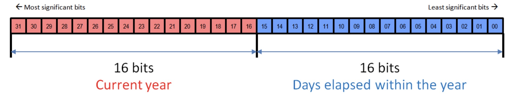
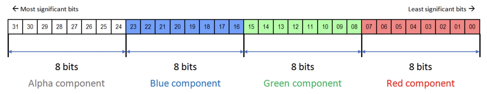
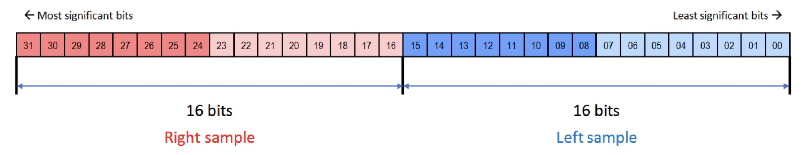
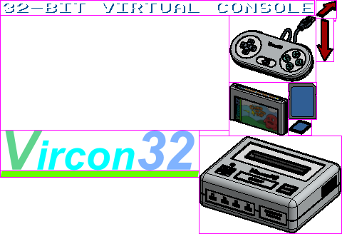
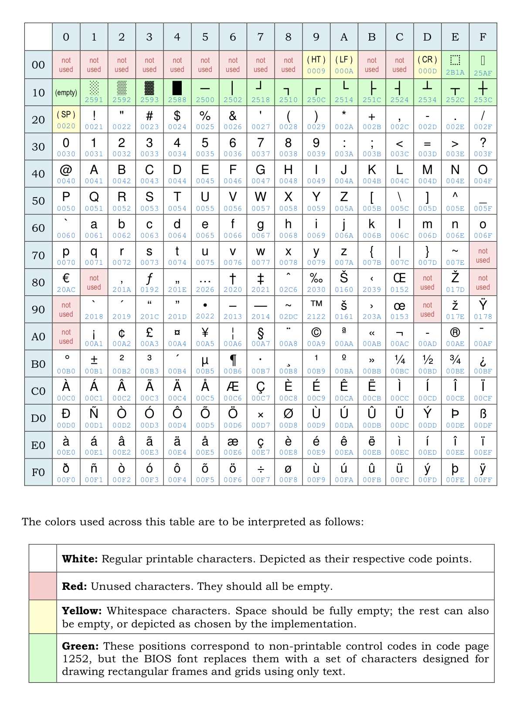
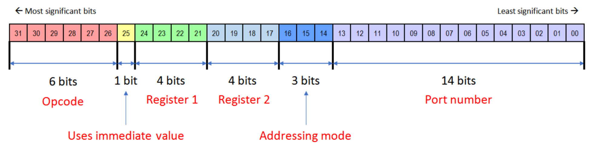
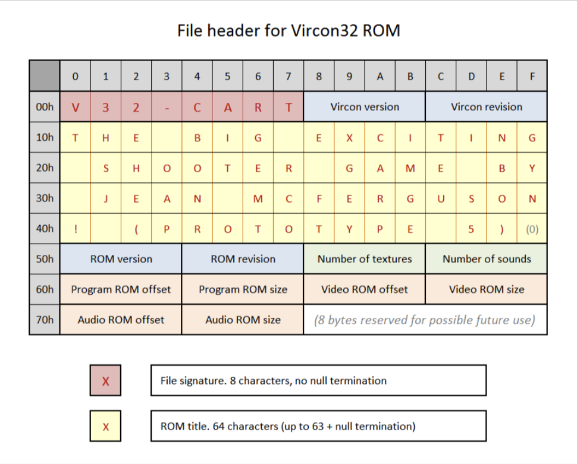
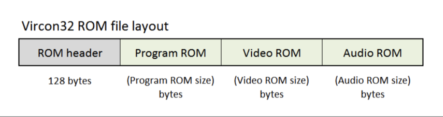
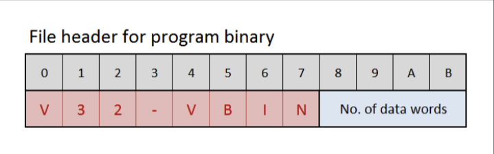
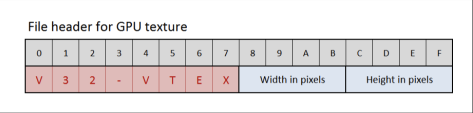

# v32ref: Vircon32 assembly language reference

An   information-dense,  quick-reference   markdown-formatted  guide   to
Vircon32  system  details and  assembly  language  mnemonics to  aid  in
development.

Information  in  this   document  is  based  on   the  official  Vircon32
Specification documents,  and the Vircon32  source code, and has been
cross-checked against the stock DesktopEmulator and DevelopmentTools sources
(`ComputerSoftware`) and the community tools ([v32as], [v32cc], [v32sim],
[v32opt]; see [Toolchain](#toolchain)). Most  images are  from the
specification documents.

This document is based on  Vircon32 DevTools **v25.1.19** or later; older
versions will contain inconsistencies.

Conventions used throughout:

  * Vircon32 is a **32-bit, word-addressed** machine: there are no bytes. Every
    address, pointer, offset, size and count in this document is in **32-bit
    words** unless it says otherwise (the cartridge/VTEX/VSND *file* offsets in
    the ROM header are the exception: those are in bytes).
  * Integers are 32-bit two's complement; floats are IEEE-754 single precision.
    A register holds either, as a bit pattern: nothing but the instruction you
    choose says how it is interpreted.
  * `DSTREG` is the register in the first operand slot (and, for most
    instructions, also the destination); `SRCREG` is the register in the second
    slot; `Immediate` is a constant that follows the instruction word.

[v32as]: https://github.com/wedge1020/v32as
[v32cc]: https://github.com/wedge1020/v32cc
[v32sim]: https://github.com/g7n-org/v32sim
[v32opt]: https://github.com/wedge1020/v32opt

## table of contents

  * [Internet Resources](#internet-resources)
  * [Toolchain](#toolchain)
  * [System Quick Reference](#system-quick-reference)
  * [Assembly Language Syntax](#assembly-language-syntax)
  * [Assembler Data Directives](#assembler-data-directives)
  * [A Minimal Program](#a-minimal-program)
  * [CPU Error Codes](#cpu-error-codes)
  * [Vircon32 Instruction Set Category Overview](#vircon32-instruction-set-category-overview)
  * [Vircon32 Instruction Set Detailed View](#vircon32-instruction-set-detailed-view)
  * [Vircon32 Registers](#vircon32-registers)
    * [General Purpose Registers](#general-purpose-registers)
    * [Internal Registers](#internal-registers)
    * [Stack Operations](#stack-operations)
    * [String Operations](#string-operations)
    * [Calling Convention](#calling-convention)
  * [Control Flags](#control-flags)
  * [Control Signals](#control-signals)
    * [How a frame runs](#how-a-frame-runs)
  * [Vircon32 Memory Map](#vircon32-memory-map)
  * [IOPorts](#ioports)
    * [Vircon32 IOPorts Layout](#vircon32-ioports-layout)
    * [TIME](#time)
    * [RNG](#rng)
    * [GPU](#gpu)
      * [GPU Commands](#gpu-commands)
      * [GPU Active Blending Port Commands](#gpu-active-blending-port-commands)
    * [SPU](#spu)
      * [SPU Commands](#spu-commands)
      * [SPU Channel States](#spu-channel-states)
    * [INPUT](#input)
    * [CARTRIDGE](#cartridge)
    * [MEMCARD](#memcard)
  * [Vircon32 Instructions](#vircon32-instructions)
  * [Vircon32 BIOS](#vircon32-bios)
    * [Vircon32 BIOS Texture](#bios-texture)
    * [Vircon32 BIOS Font](#bios-font)
  * [Vircon32 Binary Specifications](#vircon32-binary-specifications)
    * [Instruction Format](#instruction-format)
    * [Packed V32 ROM](#packed-v32-rom)
    * [Assembled VBIN](#assembled-vbin)
    * [Texture VTEX](#texture-vtex)
    * [Sound VSND](#sound-vsnd)
    * [Memory Card File](#memory-card-file)
  * [Pitfalls and Hardware Details](#pitfalls-and-hardware-details)

## Internet Resources

  * [Vircon32 home page](https://www.vircon32.com/)
  * [Vircon32 releases](https://github.com/vircon32/ComputerSoftware/releases)
  * [Vircon32 Specifications](https://github.com/vircon32/Vircon32Documents/tree/main/Specification/English/PDF%20documents):
    * [Part 1: The Vircon32 System](https://github.com/vircon32/Vircon32Documents/blob/main/Specification/English/PDF%20documents/Spec%20part%201%20-%20The%20Vircon32%20System.pdf)
    * [Part 2: Console Architecture](https://github.com/vircon32/Vircon32Documents/blob/main/Specification/English/PDF%20documents/Spec%20part%202%20-%20Console%20architecture.pdf)
    * [Part 3: The Processor (CPU)](https://github.com/vircon32/Vircon32Documents/blob/main/Specification/English/PDF%20documents/Spec%20part%203%20-%20The%20processor%20\(CPU\).pdf)
    * [Part 4: The Graphics Chip (GPU)](https://github.com/vircon32/Vircon32Documents/blob/main/Specification/English/PDF%20documents/Spec%20part%204%20-%20The%20graphics%20chip%20\(GPU\).pdf)
    * [Part 5: The Sound Chip (SPU)](https://github.com/vircon32/Vircon32Documents/blob/main/Specification/English/PDF%20documents/Spec%20part%205%20-%20The%20sound%20chip%20\(SPU\).pdf)
    * [Part 6: Controller Chips](https://github.com/vircon32/Vircon32Documents/blob/main/Specification/English/PDF%20documents/Spec%20part%206%20-%20Controller%20chips.pdf)
    * [Part 7: Other Console Components](https://github.com/vircon32/Vircon32Documents/blob/main/Specification/English/PDF%20documents/Spec%20part%207%20-%20Other%20console%20components.pdf)
    * [Part 8: External Elements](https://github.com/vircon32/Vircon32Documents/blob/main/Specification/English/PDF%20documents/Spec%20part%208%20-%20External%20elements.pdf)
    * [Part 9: File Formats](https://github.com/vircon32/Vircon32Documents/blob/main/Specification/English/PDF%20documents/Spec%20part%209%20-%20File%20formats.pdf)
  * [Vircon32 Guides](https://github.com/vircon32/Vircon32Documents/tree/main/Guides/English/PDF%20documents):
    * [C Compiler](https://github.com/vircon32/Vircon32Documents/blob/main/Guides/English/PDF%20documents/Guide%20-%20Guide%20for%20the%20C%20compiler.pdf)
    * [Console Operations](https://github.com/vircon32/Vircon32Documents/blob/main/Guides/English/PDF%20documents/Guide%20-%20How%20the%20console%20works.pdf)
    * [Making Games](https://github.com/vircon32/Vircon32Documents/blob/main/Guides/English/PDF%20documents/Guide%20-%20How%20to%20make%20games.pdf)
    * [Learning C](https://github.com/vircon32/Vircon32Documents/blob/main/Guides/English/PDF%20documents/Guide%20-%20Learning%20C%20language.pdf)
    * [Assembly](https://github.com/vircon32/Vircon32Documents/blob/main/Guides/English/PDF%20documents/Guide%20-%20Programming%20in%20assembly.pdf)
  * [Vircon32 github](https://github.com/vircon32):
    * [ComputerSoftware.git](https://github.com/vircon32/ComputerSoftware)
    * [ConsoleSoftware.git](https://github.com/vircon32/ConsoleSoftware)
    * [CommunityContent.git](https://github.com/vircon32/CommunityContent)

## Toolchain

| Tool              | Purpose                                                                |
| ----------------- | ---------------------------------------------------------------------- |
| `assemble`        | official assembler: `.asm` to `.vbin`                                  |
| `compile`         | official C compiler: `.c` to `.asm`                                    |
| `packrom`         | official packer: `.vbin` + textures + sounds to a `.v32` cartridge     |
| [v32as]           | assembler (C port, drop-in for `assemble`, plus macros and extensions) |
| `v32ld`           | linker for `v32as -C` relocatable objects (ships with v32as)           |
| [v32cc]           | C compiler (stock dialect and ISO C, separate compilation, libc)       |
| [v32opt]          | peephole optimizer for generated assembly                              |
| [v32sim]          | text-mode debugger/simulator (breakpoints, watchpoints, screenshots)   |

The usual flow is `compile` (or hand-written assembly) to `.asm`, `assemble`
to `.vbin`, then `packrom` to a `.v32` cartridge (see [Packed V32
ROM](#packed-v32-rom)). `v32as -g` writes a `.debug` file (address, file, line,
label) that [v32sim] loads for source-level display.

## System Quick Reference

| Attribute                   | Value                             |
| --------------------------- | --------------------------------- |
| VirconVersion               | 1                                 |
| VirconRevision              | 0                                 |
| FramesPerSecond             | 60                                |
| CyclesPerSecond             | 15,000,000                        |
| CyclesPerFrame              | CyclesPerSecond / FramesPerSecond |
| ScreenWidth                 | 640                               |
| ScreenHeight                | 360                               |
| GPUTextureSize              | 1024x1024                         |
| GPUMaximumCartridgeTextures | 256                               |
| GPURegionsPerTexture        | 4096                              |
| GPUPixelCapacityPerFrame    | 9 * ScreenPixels                  |
| GPUClearScreenPenalty       | -0.50f                            |
| GPUScalingPenalty           | +0.15f                            |
| GPURotationPenalty          | +0.25f                            |
| SPUMaximumCartridgeSounds   | 1024                              |
| SPUMaximumCartridgeSamples  | 1024 * 1024 * 256                 |
| SPUMaximumBiosSamples       | 1024 * 1024 * 1                   |
| SPUSoundChannels            | 16                                |
| SPUSamplingRate             | 44,100                            |
| SPUSamplesPerFrame          | SPUSamplingRate / FramesPerSecond |
| MaximumCartridgeProgramROM  | 1024 * 1024 * 128                 |
| MaximumBiosProgramROM       | 1024 * 1024 * 1                   |
| RAMSize                     | 1024 * 1024 * 4                   |
| MemoryCardSize              | 1024 * 256                        |
| MemoryBusSlaves             | 4                                 |
| ControlBusSlaves            | 8                                 |
| GamepadPorts                | 4                                 |

NOTE: `RAMSize`, `MemoryCardSize` and the `MaximumProgramROM` values are in
**words**  (RAM: 4M words = 16MB; memory card: 256k words = 1MB; cartridge ROM:
128M words = 512MB). `CyclesPerFrame` is 250,000 and `SPUSamplesPerFrame` is
735.

NOTE: the three GPU "penalty"  values  are not a screen  size:  see [GPU
pixel budget](#gpu-pixel-budget) for how they are applied.

## Assembly Language Syntax

A source file is a sequence of lines; each line holds an optional label, an
optional instruction or data directive, and an optional comment.

```
; a comment runs from ';' to the end of the line
_label:                         ; labels start with '_' and end with ':'
    mov   R0, 0x10              ; MNEMONIC  operand, operand
    out   GPU_Command, GPUCommand_ClearScreen
```

  * **Labels** begin with an underscore (`_start`, `_draw_loop`), are
    case-sensitive, and stand for a *word address*. They can be used before
    they are defined. A label may share a line with the statement after it.
  * **Mnemonics**, **register names**, IOPort names, constants and `true`/`false`
    are case-insensitive (`mov R0, R1`). The stock headers use lowercase mnemonics
    and uppercase registers. IOPort names and constants (`GPU_Command`,
    `GPUCommand_ClearScreen`, ...) are listed in the [IOPorts](#ioports) section.
  * **Registers**: `R0`-`R15`; `R11`-`R15` may also be written `CR`, `SR`, `DR`,
    `BP`, `SP`. `IP`, `IR`, `IV` are *not* CPU registers (see [Internal
    Registers](#internal-registers)).
  * **Numbers**: decimal (`42`, `-7`), hexadecimal (`0x2A`) and floating point
    (`3.14`, `-0.25`). An integer must fit in 32 bits (`0xFFFFFFFF` is -1).
    Character literals (`'A'`, an integer) and `true`/`false` (1/0) work too.
    [v32as] adds `0b1010`, `2Ah`, `#42` and `label +/- integer` operands,
    unless run with `--standard`.
  * **Leading zeros are a trap**: the official assembler reads `0100` as the
    *decimal* number 100, while [v32as] (without `--standard`) reads it as
    *octal*. Do not write leading zeros.
  * **Strings** are written in double quotes with the escapes `\n`, `\r`,
    `\t`, `\\`, `\'`, `\"` and `\xHH` (an unknown escape is a warning).
  * **Preprocessor** (official): `%define NAME tokens`, `%undef`, `%ifdef`,
    `%ifndef`, `%else`, `%endif`, `%include "file"`, `%error "msg"`,
    `%warning "msg"` (directive names are lowercase). [v32as] adds function-like macros, `%if`/`%elif`,
    `%assign`, `%macro`/`%rep`, `.local` labels and more (see its README).
    `%define` is how compiled code names RAM variables (`%define global_x
    0x00000010`): a `%define` can stand for any constant, not just a number.
  * There is no relative addressing for jumps: `JMP`/`CALL`/`JT`/`JF` take an
    absolute address (label, number or register).

### Instruction size and operand forms

An instruction occupies **1 word**, or **2 words** when it has an *Immediate*
(the second word is the constant, see [Instruction
Format](#instruction-format)). A label used as an operand is an immediate.

| Mnemonics                                                    | Operand forms                              |
| ------------------------------------------------------------ | ------------------------------------------ |
| `HLT` `WAIT` `RET` `MOVS` `SETS`                             | none                                       |
| `PUSH` `POP` `CMPS` `CIF` `CFI` `CIB` `CFB` `NOT` `BNOT`     | `reg`                                      |
| `ISGN` `IABS` `FSGN` `FABS` `FLR` `CEIL` `ROUND` `SIN`       | `reg`                                      |
| `ACOS` `LOG`                                                 | `reg`                                      |
| `IEQ`..`ILE` `AND` `OR` `XOR` `SHL` `IADD`..`IMOD` `IMIN` `IMAX` | `reg, reg` or `reg, integer`           |
| `FEQ`..`FLE` `FADD`..`FMOD` `FMIN` `FMAX`                    | `reg, reg` or `reg, number`                |
| `ATAN2` `POW`                                                | `reg, reg` (**no immediate form**)         |
| `JMP` `CALL`                                                 | `reg` or `address`                         |
| `JT` `JF`                                                    | `reg, reg` or `reg, address`               |
| `LEA`                                                        | `reg, [reg]` or `reg, [reg+integer]`       |
| `IN`                                                         | `reg, port`                                |
| `OUT`                                                        | `port, reg` or `port, number`              |
| `MOV`                                                        | the 8 forms of [MOV](#MOV)                 |

Things the table implies that are easy to forget:

  * `PUSH` takes only a register: to push a constant, `MOV` it to a register
    first.
  * `MOV` cannot store an immediate to memory, cannot copy memory to memory
    (use [MOVS](#MOVS)), and cannot take a label in its `[reg+offset]` forms:
    the offset is a plain integer. Use `MOV R1, _label` then `[R1+n]`.
  * `LEA` takes only `[reg]` / `[reg+integer]`: to get a label's address, use
    `MOV Rn, _label`.
  * `ATAN2` and `POW` need both values in registers.
  * `[R+0]` and `[R]` are the same instruction (the assembler encodes
    `[R+0]` as `[R]`).
  * **Float immediates**: for the float instructions (`FEQ`..`FLE`, `FADD`..`FMOD`,
    `FMIN`, `FMAX`) a number given as an immediate is converted to a float
    bit pattern by the assembler: `FADD R0, 1` adds `1.0`. The *integer*
    instructions reject a float literal. `MOV R0, 1.5` and `OUT
    GPU_DrawingScaleX, 2.0` store the bit pattern of the float. Remember that a
    hex literal is always a raw bit pattern, never converted.

### Internal registers in v32as (extension)

[v32as] lets `MOV` read and write `IP`, `IR`, `IV` by expanding to one real
instruction: `MOV Rn, IP` (address of the next instruction), `MOV IP, Rn`
(a jump), `MOV Rn, IR`, and `MOV IR, Rn` / `MOV IV, Rn` (patch the next
instruction word / immediate: only works in code running from RAM). The
official assembler does not accept these.

## Assembler Data Directives

| keyword  | form                           | words emitted                                   |
| -------- | ------------------------------ | ----------------------------------------------- |
| integer  | `integer 1, -2, 0x10`          | one word per value                              |
| float    | `float 1.5, -0.25, 3`          | one word per value (`3` becomes `3.0`)          |
| string   | `string "text\n"`              | one word **per character**, then a `0` word     |
| pointer  | `pointer _a, _b`               | one word per label: its address                 |
| datafile | `datafile "path/to/file.bin"`  | the file's contents as little-endian words      |

Use commas to separate values (create "array" of values).

[v32as] extras (not in the official assembler): `zstring "text"` packs four
characters per word (first character in the low byte, zero terminated, last
word zero padded),
`global _name` / `extern _name` for linking `v32as -C` objects.

Things to know:

  * A `string` is **not** a C byte string: each character takes a whole word
    (this is why C strings are `int*` in the Vircon32 headers).
  * `datafile` sizes must be a multiple of 4 bytes.
  * There are no `org`, alignment or "reserve space" directives. Directives
    emit data **into the program ROM**, so labelled data is read-only
    (writing to a CART address raises `InvalidMemoryWrite`). Writable variables
    must live in RAM (`0x00000000`-`0x003FFFFF`) at addresses you assign
    yourself, typically with `%define`; initialize them at start-up, copying
    initial values out of ROM with [MOVS](#MOVS). The stack grows down from the
    top of RAM, so keep variables near the bottom.
  * Code and data share one stream: the first word of the program is the entry
    point (execution starts at `0x20000000`), so put your start-up code first,
    and never let execution run into data.

## A Minimal Program

Clear the screen to dark blue and print a line of text with the BIOS font,
once per frame:

```
; hello.asm
_start:
    out   GPU_SelectedTexture, -1       ; texture -1 is the BIOS texture (font)
    out   GPU_ClearColor, 0xFF400000    ; colors are 0xAABBGGRR: opaque, blue 0x40

_frame:
    out   GPU_Command, GPUCommand_ClearScreen
    mov   R1, _text                     ; R1 = address of the next character
    mov   R2, 100                       ; R2 = x of the next character
    mov   R3, 100                       ; R3 = y

_next_char:
    mov   R0, [R1]                      ; one word per character
    jf    R0, _done                     ; the 0 terminator ends the string
    out   GPU_SelectedRegion, R0        ; BIOS font: region number = character code
    out   GPU_DrawingPointX, R2
    out   GPU_DrawingPointY, R3
    out   GPU_Command, GPUCommand_DrawRegion
    iadd  R1, 1
    iadd  R2, 10                        ; each BIOS character is 10 pixels wide
    jmp   _next_char

_done:
    wait                                ; stall until the next frame starts
    jmp   _frame

_text:
    string "HELLO VIRCON32"
```

Build: `assemble hello.asm` (or `v32as hello.asm`) writes `hello.vbin`; pack it
with `packrom` (a cartridge with no textures or sounds needs just the program)
and run the `.v32` file in an emulator, or in [v32sim].

## CPU Error Codes

Runtime errors that Vircon32 generates:

| Value | Type                 | Description                             |
| ----- | -------------------- | --------------------------------------- |
| `0`   | `InvalidMemoryRead`  | read from invalid memory location       |
| `1`   | `InvalidMemoryWrite` | write to invalid memory location        |
| `2`   | `InvalidPortRead`    | invalid read from write-only port       |
| `3`   | `InvalidPortWrite`   | invalid write to read-only port         |
| `4`   | `StackOverflow`      | push would exceed lower bound of memory |
| `5`   | `StackUnderflow`     | pop would exceed upper bound of memory  |
| `6`   | `DivisionError`      | division by zero                        |
| `7`   | `ArcCosineError`     | undefined value                         |
| `8`   | `ArcTangent2Error`   | undefined value                         |
| `9`   | `LogarithmError`     | undefined value                         |
| `10`  | `PowerError`         | undefined value                         |

When does each one occur?

| Error                | Raised when                                                      |
| -------------------- | ---------------------------------------------------------------- |
| `InvalidMemoryRead`  | read outside the four pages, or past the end of a page           |
| `InvalidMemoryWrite` | write outside the pages, or to BIOS or CART (both read-only)     |
| `InvalidPortRead`    | `IN` from a write-only port (`GPU_Command`, `SPU_Command`, ...)  |
| `InvalidPortWrite`   | `OUT` to a read-only port (`GPU_RemainingPixels`, `INP_*`, ...)  |
| `StackOverflow`      | `PUSH`/`CALL` that would decrement `SP` below 0 (RAM start)      |
| `StackUnderflow`     | `POP`/`RET` after which `SP` is beyond the end of RAM            |
| `DivisionError`      | `IDIV`, `IMOD`, `FDIV` or `FMOD` with a divisor of zero          |
| `ArcCosineError`     | `ACOS` of a value outside -1.0 to 1.0                            |
| `ArcTangent2Error`   | `ATAN2` with both operands zero                                  |
| `LogarithmError`     | `LOG` of zero or a negative value                                |
| `PowerError`         | `POW` of a negative base with a non-integer exponent             |

Note that **float division by zero is an error, not infinity**: nothing in
the system produces an infinity or NaN through arithmetic. Guard divisors.

### What the CPU does on an error

The error is not a trap you can catch: the CPU stores the machine state in
registers, resets the stack, and jumps to the BIOS error handler, which
displays the failure on screen and halts.

| Register | Receives                                                                   |
| -------- | -------------------------------------------------------------------------- |
| `R0`     | error code (the `Value` above)                                             |
| `R1`     | address of the instruction *after* the one that failed (including its immediate word) |
| `R2`     | the failing instruction word (`InstructionRegister`)                       |
| `R3`     | the failing instruction's immediate (`ImmediateValue`)                     |
| `SP`/`BP`| reset to `0x003FFFFF`                                                      |
| `IP`     | set to `0x10000000` (BIOS error handler)                                   |

A faulting instruction does not complete: its destination is left unchanged.

Stack details (`CALL` is a push and `RET` a pop):

  * `PUSH`/`CALL` decrement `SP` first; only if that goes below 0 is it a
    `StackOverflow`. If `SP` points elsewhere (e.g. into ROM) the write simply
    fails as `InvalidMemoryWrite`.
  * `POP`/`RET` read first (a bad address is an `InvalidMemoryRead`), then
    increment `SP`; an `SP` past the last word of RAM is a `StackUnderflow`.
    Since `SP` starts at the last word, a `RET` or `POP` with nothing pushed
    reads that word and then fails with `StackUnderflow`.
  * `PUSH SP` pushes the value `SP` had *before* the decrement.

Bad jumps are detected late: `JMP`/`CALL`/`JT`/`JF`/`RET` to an unreadable
address succeed, and the error is raised by the *next instruction fetch*. In
that case `R1` holds the bad address plus one, and `R2`/`R3` still hold the
`JMP`'s (previous instruction's) word and immediate.

After an error the console abandons the rest of the current frame: the BIOS
error handler starts running at the next frame.

## Assembler Data Directives

| keyword  | description                  |
| -------- | ---------------------------- |
| integer  | specify one or more integers |
| float    | specify one or more floats   |
| string   | specify string sequence(s?)  |
| pointer  | specify pointer(s?)          |
| datafile | specify datafile(s?)         |

Use commas to separate values (create "array" of values)

## Vircon32 Instruction Set Category Overview

| branch / ctrl | compare     | data          | logic         | arithmetic    | float math      |
| ------------- | ----------- | ------------- | ------------- | ------------- | --------------- |
| [HLT](#HLT)   | [IEQ](#IEQ) | [MOV](#MOV)   | [NOT](#NOT)   | [IADD](#IADD) | [FLR](#FLR)     |
| [WAIT](#WAIT) | [INE](#INE) | [LEA](#LEA)   | [AND](#AND)   | [ISUB](#ISUB) | [CEIL](#CEIL)   |
| [JMP](#JMP)   | [IGT](#IGT) | [PUSH](#PUSH) | [OR](#OR)     | [IMUL](#IMUL) | [ROUND](#ROUND) |
| [CALL](#CALL) | [IGE](#IGE) | [POP](#POP)   | [XOR](#XOR)   | [IDIV](#IDIV) | [SIN](#SIN)     |
| [RET](#RET)   | [ILT](#ILT) | [IN](#IN)     | [BNOT](#BNOT) | [IMOD](#IMOD) | [ACOS](#ACOS)   |
| [JT](#JT)     | [ILE](#ILE) | [OUT](#OUT)   | [SHL](#SHL)   | [ISGN](#ISGN) | [ATAN2](#ATAN2) |
| [JF](#JF)     | [FEQ](#FEQ) | [MOVS](#MOVS) |               | [IMIN](#IMIN) | [LOG](#LOG)     |
|               | [FNE](#FNE) | [SETS](#SETS) |               | [IMAX](#IMAX) | [POW](#POW)     |
|               | [FGT](#FGT) | [CMPS](#CMPS) |               | [IABS](#IABS) |                 |
|               | [FGE](#FGE) | [CIF](#CIF)   |               | [FADD](#FADD) |                 |
|               | [FLT](#FLT) | [CFI](#CFI)   |               | [FSUB](#FSUB) |                 |
|               | [FLE](#FLE) | [CIB](#CIB)   |               | [FMUL](#FMUL) |                 |
|               |             | [CFB](#CFB)   |               | [FDIV](#FDIV) |                 |
|               |             |               |               | [FMOD](#FMOD) |                 |
|               |             |               |               | [FSGN](#FSGN) |                 |
|               |             |               |               | [FMIN](#FMIN) |                 |
|               |             |               |               | [FMAX](#FMAX) |                 |
|               |             |               |               | [FABS](#FABS) |                 |

More  information can  be found  in the  Section 3:  The Processor  (CPU)
Specifications document.

## Vircon32 Instruction Set Detailed View

There are 64 CPU opcodes, instructions  encode them in 6 bits. No invalid
opcodes can  exist. HLT is  opcode 0 for safety:  if an empty  or invalid
instruction is found, the CPU will stop execution.

| opcode | binary | mneumonic       | category   | operands | description            |
| ------ | ------ | --------------- | ---------- | -------- | ---------------------- |
| 0x00   | 000000 | [HLT](#HLT)     | control    | 0        | halt processing        |
| 0x01   | 000001 | [WAIT](#WAIT)   | control    | 0        | wait for new frame     |
| 0x02   | 000010 | [JMP](#JMP)     | branch     | 1        | unconditional jump     |
| 0x03   | 000011 | [CALL](#CALL)   | branch     | 1        | call subroutine        |
| 0x04   | 000100 | [RET](#RET)     | branch     | 0        | return from subroutine |
| 0x05   | 000101 | [JT](#JT)       | branch     | 2        | jump if true (1)       |
| 0x06   | 000110 | [JF](#JF)       | branch     | 2        | jump if false (0)      |
| 0x07   | 000111 | [IEQ](#IEQ)     | compare    | 2        | int equal              |
| 0x08   | 001000 | [INE](#INE)     | compare    | 2        | int not equal          |
| 0x09   | 001001 | [IGT](#IGT)     | compare    | 2        | int greater than       |
| 0x0A   | 001010 | [IGE](#IGE)     | compare    | 2        | int greater than/equal |
| 0x0B   | 001011 | [ILT](#ILT)     | compare    | 2        | int less than          |
| 0x0C   | 001100 | [ILE](#ILE)     | compare    | 2        | int less than or equal |
| 0x0D   | 001101 | [FEQ](#FEQ)     | compare    | 2        | FP equal               |
| 0x0E   | 001110 | [FNE](#FNE)     | compare    | 2        | FP not equal           |
| 0x0F   | 001111 | [FGT](#FGT)     | compare    | 2        | FP greater than        |
| 0x10   | 010000 | [FGE](#FGE)     | compare    | 2        | FP greater than/equal  |
| 0x11   | 010001 | [FLT](#FLT)     | compare    | 2        | FP less than           |
| 0x12   | 010010 | [FLE](#FLE)     | compare    | 2        | FP less than or equal  |
| 0x13   | 010011 | [MOV](#MOV)     | data       | 2        | copy data              |
| 0x14   | 010100 | [LEA](#LEA)     | data       | 2        | load effective address |
| 0x15   | 010101 | [PUSH](#PUSH)   | data       | 1        | push data to stack     |
| 0x16   | 010110 | [POP](#POP)     | data       | 1        | pop data from stack    |
| 0x17   | 010111 | [IN](#IN)       | data       | 2        | read data in from port |
| 0x18   | 011000 | [OUT](#OUT)     | data       | 2        | write data out to port |
| 0x19   | 011001 | [MOVS](#MOVS)   | data       | 0        | move string            |
| 0x1A   | 011010 | [SETS](#SETS)   | data       | 0        | set string             |
| 0x1B   | 011011 | [CMPS](#CMPS)   | data       | 1        | compare string         |
| 0x1C   | 011100 | [CIF](#CIF)     | data       | 1        | integer to float       |
| 0x1D   | 011101 | [CFI](#CFI)     | data       | 1        | float to integer       |
| 0x1E   | 011110 | [CIB](#CIB)     | data       | 1        | integer to boolean     |
| 0x1F   | 011111 | [CFB](#CFB)     | data       | 1        | float to boolean       |
| 0x20   | 100000 | [NOT](#NOT)     | logic      | 1        | bitwise NOT            |
| 0x21   | 100001 | [AND](#AND)     | logic      | 2        | bitwise AND            |
| 0x22   | 100010 | [OR](#OR)       | logic      | 2        | bitwise inclusive OR   |
| 0x23   | 100011 | [XOR](#XOR)     | logic      | 2        | bitwise XOR            |
| 0x24   | 100100 | [BNOT](#BNOT)   | logic      | 1        | boolean NOT            |
| 0x25   | 100101 | [SHL](#SHL)     | logic      | 2        | left shift             |
| 0x26   | 100110 | [IADD](#IADD)   | arithmetic | 2        | integer addition       |
| 0x27   | 100111 | [ISUB](#ISUB)   | arithmetic | 2        | integer subtraction    |
| 0x28   | 101000 | [IMUL](#IMUL)   | arithmetic | 2        | integer multiplication |
| 0x29   | 101001 | [IDIV](#IDIV)   | arithmetic | 2        | integer division       |
| 0x2A   | 101010 | [IMOD](#IMOD)   | arithmetic | 2        | integer modulus        |
| 0x2B   | 101011 | [ISGN](#ISGN)   | arithmetic | 1        | integer sign toggle    |
| 0x2C   | 101100 | [IMIN](#IMIN)   | arithmetic | 2        | integer minimum        |
| 0x2D   | 101101 | [IMAX](#IMAX)   | arithmetic | 2        | integer maximum        |
| 0x2E   | 101110 | [IABS](#IABS)   | arithmetic | 1        | integer absolute value |
| 0x2F   | 101111 | [FADD](#FADD)   | arithmetic | 2        | float addition         |
| 0x30   | 110000 | [FSUB](#FSUB)   | arithmetic | 2        | float subtraction      |
| 0x31   | 110001 | [FMUL](#FMUL)   | arithmetic | 2        | float multiplication   |
| 0x32   | 110010 | [FDIV](#FDIV)   | arithmetic | 2        | float division         |
| 0x33   | 110011 | [FMOD](#FMOD)   | arithmetic | 2        | float modulus          |
| 0x34   | 110100 | [FSGN](#FSGN)   | arithmetic | 1        | float sign toggle      |
| 0x35   | 110101 | [FMIN](#FMIN)   | arithmetic | 2        | float minimum          |
| 0x36   | 110110 | [FMAX](#FMAX)   | arithmetic | 2        | float maximum          |
| 0x37   | 110111 | [FABS](#FABS)   | arithmetic | 1        | float absolute value   |
| 0x38   | 111000 | [FLR](#FLR)     | float math| 1        | float floor            |
| 0x39   | 111001 | [CEIL](#CEIL)   | float math| 1        | float ceiling          |
| 0x3A   | 111010 | [ROUND](#ROUND) | float math| 1        | float rounding         |
| 0x3B   | 111011 | [SIN](#SIN)     | float math| 1        | float sine             |
| 0x3C   | 111100 | [ACOS](#ACOS)   | float math| 1        | float arc cosine       |
| 0x3D   | 111101 | [ATAN2](#ATAN2) | float math| 2        | float arc tangent      |
| 0x3E   | 111110 | [LOG](#LOG)     | float math| 1        | float natural log      |
| 0x3F   | 111111 | [POW](#POW)     | float math| 2        | float power            |

More  information can  be found  in the  Section 3:  The Processor  (CPU)
Specifications document.

## Vircon32 Registers

Vircon32 has 16 general purpose registers and 3 internal registers.

The general purpose registers can hold either an **integer** or a **floating
point** value; which one is decided by the instruction operating on them (a
register has no type). All are 32 bits.

`R11`-`R13` are implicitly used by [MOVS](#MOVS), [SETS](#SETS) and
[CMPS](#CMPS), and `R14`/`R15` by the stack instructions ([PUSH](#PUSH),
[POP](#POP), [CALL](#CALL), [RET](#RET)); avoid keeping other values in them
across those instructions. At reset `SP` and `BP` both hold `0x003FFFFF`, the last
word of RAM. The assembler accepts `R11`-`R15` or the alias names
interchangeably.

### General Purpose Registers

| Register | Binary | Alias | Description                  |
| -------- | ------ | ----- | ---------------------------- |
| `R0`     | `0000` |       |                              |
| `R1`     | `0001` |       |                              |
| `R2`     | `0010` |       |                              |
| `R3`     | `0011` |       |                              |
| `R4`     | `0100` |       |                              |
| `R5`     | `0101` |       |                              |
| `R6`     | `0110` |       |                              |
| `R7`     | `0111` |       |                              |
| `R8`     | `1000` |       |                              |
| `R9`     | `1001` |       |                              |
| `R10`    | `1010` |       |                              |
| `R11`    | `1011` | `CR`  | string: count register       |
| `R12`    | `1100` | `SR`  | string: source register      |
| `R13`    | `1101` | `DR`  | string: destination register |
| `R14`    | `1110` | `BP`  | stack: base pointer (base)   |
| `R15`    | `1111` | `SP`  | stack: stack pointer (top)   |

### Internal Registers

The Vircon32 internal registers are used  in the operation of the system,
and are  not directly  accessible to  the user  via programming.  Some of
these registers can be influenced based on actions taken.

| Register              | Description                                   |
| --------------------- | --------------------------------------------- |
| `InstructionPointer`  | address where CPU reads the next instruction  |
| `InstructionRegister` | stores last read instruction (currently run)  |
| `ImmediateValue`      | if `immflag` is set, place that value here    |

The   **branch**  instructions   ([JMP](#JMP), [CALL](#CALL), [RET](#RET),
[JT](#JT), [JF](#JF)) redirect program flow  by altering  the
**InstructionPointer**  (versus  just  proceeding to  the  next
instruction in sequence). By the time an instruction executes, the
InstructionPointer already points past it (and past its immediate word, if
any): this is the address [CALL](#CALL) saves.

Any  instruction  that accepts  an  **Immediate**  value loads it into  this
internal **ImmediateValue** register.

On a [CPU error](#cpu-error-codes) the three internal registers are what get
reported in `R1`-`R3`.

### Stack Operations

The stack is  a convenient and often-used strategy on  the CPU. It relies
on the  tracking of  an otherwise  unused (or  carefully conflict-averse)
region of memory, typically located at the end of an addressable range of
RAM. There are two components: the base  of the stack, and the top of the
stack.

When you [PUSH](#PUSH) an item onto the stack, the stack pointer register
(**SP**) is decremented by one word, and the intended value stored at the
memory location stored therein.

When you [POP](#POP)  an item off the  stack, the value in  memory at the
current  location  stored  in  the stack  pointer  register  (**SP**)  is
obtained, then the stack pointer  register (**SP**) is incremented by one
word.

So **SP always points at the most recently pushed word**. SP starts at
`0x003FFFFF` (the last word of RAM) and is decremented *before* the store, so
the first push lands at `0x003FFFFE`. [CALL](#CALL) pushes the address of the
next instruction, and [RET](#RET) pops it into the InstructionPointer. No
instruction touches `BP`: it is only a convention for stack frames (see
[Calling Convention](#calling-convention)).

### String Operations

For a  small subset of  instructions, typically intended  for string-like
operations (in the  C sense: a string is an  array of individual values),
the CR/SR/DR registers can be  used to facilitate iterative operations on
data.

The three  instructions that utilize  this functionality on  Vircon32 are
[MOVS](#MOVS), [SETS](#SETS), and [CMPS](#CMPS).

| Register | Role                              | MOVS            | SETS            | CMPS            |
| -------- | --------------------------------- | --------------- | --------------- | --------------- |
| `CR`     | count (`R11`)                     | repeat count    | repeat count    | repeat count    |
| `SR`     | source (`R12`)                    | source address  | **value** to store | address to compare against |
| `DR`     | destination (`R13`)               | destination address | destination address | address compared |

Typical use (copy 100 words, then clear 50):

```
    mov   SR, _source            ; address to copy from
    mov   DR, 0x00000100         ; address to copy to
    mov   CR, 100                ; number of words
    movs

    mov   SR, 0                  ; the value to store
    mov   DR, 0x00000200
    mov   CR, 50
    sets
```

The instructions leave `SR`, `DR` and `CR` modified (advanced and counted
down), so reload them before each use. A `CR` of 0 (or negative) still moves
**one** word, not none: guard zero-length operations with a [JF](#JF) first.

### Calling Convention

The assembly language has no notion of functions; [CALL](#CALL) and
[RET](#RET) only save and restore the return address. The stock C compiler
(and [v32cc]) follow this convention, which hand-written assembly should
share so it can call, and be called by, compiled code:

  * `R0`-`R10` are temporaries; the **return value comes back in `R0`**.
  * **No register survives a call.** The caller saves whatever it still needs
    (in its own frame); a callee never has to save anything.
  * Arguments are passed on the stack. The caller reserves space, stores
    argument *i* at `[SP+i]` and calls. Inside the callee, with the standard
    prologue, argument *i* is at `[BP+2+i]`, the return address at `[BP+1]`,
    and locals at `[BP-1]` and below.
  * Frame: `push BP` / `mov BP, SP` / `isub SP, N`; epilogue: `mov SP, BP` /
    `pop BP` / `ret`. The caller removes its argument space after the call.
  * A function returning a struct receives a hidden first argument: a pointer
    to the caller's buffer.
  * Everything is a word: `char`, `short`, `int` and pointers all take one
    word (`sizeof(int) == 1`). In the stock dialect `NULL` is `-1`, so an
    uninitialized pointer (0) is *not* null.

```
; int add(int a, int b)
_add:
    push  BP
    mov   BP, SP
    mov   R0, [BP+2]            ; a
    mov   R1, [BP+3]            ; b
    iadd  R0, R1                ; result in R0
    mov   SP, BP
    pop   BP
    ret

; ... caller: add(3, 4)
    isub  SP, 2                 ; space for two arguments
    mov   R0, 3
    mov   [SP], R0
    mov   R0, 4
    mov   [SP+1], R0
    call  _add
    iadd  SP, 2                 ; result is in R0
```

[v32cc]'s start-up code is `call main` followed by `hlt`.

## Control Flags

The CPU Control  Flags halt the CPU in  specific situations, interrupting
normal operations.

| Name       | Description                         |
| ---------- | ----------------------------------- |
| `HaltFlag` | halt CPU until reset or power cycle |
| `WaitFlag` | halt CPU until next frame commences |

Flag values are 0 when reset, 1 when set.

## Control Signals

| signal   | description                                                       |
| -------- | ----------------------------------------------------------------- |
| `Reset`  | Halt/Wait flags, registers reset; BP, SP = `0x003FFFFF`, IP = `0x10000004` (BIOS start) |
| `Frame`  | Wait flag is reset                                                |
| `Cycle`  | if control flags set, do nothing; otherwise, do instruction cycle |

A reset (and power-on) sets `R0`-`R15` to zero (except `SP`/`BP`), **clears
all of RAM to zero**, resets the RNG, timer counters, GPU and SPU to the
defaults in their port tables, and selects gamepad 0. It does not touch the
cartridge, the memory card or which gamepads are connected.

### How a frame runs

The console is run one frame at a time (60 per second):

  1. **Frame start**: the timer counters advance (`TIM_FrameCounter`
     incremented, `TIM_CycleCounter` = 0, the clock ticks every 60 frames), the
     CPU's wait flag is cleared, the GPU's `GPU_RemainingPixels` is refilled,
     the SPU produces this frame's audio and advances its channels, and the
     gamepad states for this frame are latched.
  2. **Run the CPU**: instructions run, one per cycle (the cycle counter is
     incremented *before* each), until `CyclesPerFrame` = 250,000 cycles have
     passed, or the CPU executes [WAIT](#WAIT) or [HLT](#HLT), or a CPU error
     occurs. A frame that ends early does not make the next one longer.
  3. **Frame end**: a modified memory card is written back to its file.

Two consequences: a program that spends more than 250,000 cycles between
`WAIT`s misses the 60 FPS cadence (the work carries over into the next frame),
and everything a program does in a frame (drawing, sound commands) is seen as
one batch.

## Vircon32 Memory Map

| Name                            | Address    | Description                           |
| ------------------------------- | ---------- | ------------------------------------- |
| RAMFirstAddress                 | 0x00000000 | read/write memory (16MB, 4MW)         |
| stack init address              | 0x003FFFFF | SP/BP value at reset (grows downward) |
| RAM last address                | 0x003FFFFF | last addressable offset in RAM        |
| BiosProgramROMFirstAddress      | 0x10000000 | Vircon32 BIOS (4MB, 1MW)              |
| BIOS error handler address      | 0x10000000 | start of error handler logic          |
| BIOS program start address      | 0x10000004 | start of BIOS main logic              |
| BIOS last address               | 0x100FFFFF | last addressable offset in BIOS       |
| CartridgeProgramROMFirstAddress | 0x20000000 | first offset in CART (512MB, 128MW)   |
| CART last address               | 0x27FFFFFF | last addressable offset in CART       |
| MemoryCardRAMFirstAddress       | 0x30000000 | first offset in MEMCARD (1MB, 256kW)  |
| MEMCARD last address            | 0x3003FFFF | last addressable offset in MEMCARD    |

The page is selected by **address bits 28-29** (`0` RAM, `1` BIOS, `2` CART,
`3` MEMCARD); bits 30-31 are ignored, so `0x40000000` reads as `0x00000000`,
`0x90000000` as `0x10000000` and so on. The remaining 28 bits are the offset
within the page; one past the end of the page's contents is an invalid access.
The BIOS and CART pages are only as big as the loaded program ROM (a program
reading past its own last word gets `InvalidMemoryRead`). RAM and the memory
card are read/write; **BIOS and CART are read-only** (a write raises
`InvalidMemoryWrite`). Without a cartridge or memory card inserted, that page
is not accessible, see `CAR_Connected` and `MEM_Connected`. The program runs
directly from the CART page, so `LEA`/`MOV` of a code or data label yields an
address in `0x2xxxxxxx`.

# IOPorts

## Vircon32 IOPorts Layout

| Address | Vircon32 ID                 | Description                |
| ------- | --------------------------- | -------------------------- |
| `0x000` | [TIM_FirstPort](#TIME)      | time related functionality |
| `0x100` | [RNG_FirstPort](#RNG)       | random number generator    |
| `0x200` | [GPU_FirstPort](#GPU)       | graphics                   |
| `0x300` | [SPU_FirstPort](#SPU)       | sound processing           |
| `0x400` | [INP_FirstPort](#INPUT)     | input (game controllers)   |
| `0x500` | [CAR_FirstPort](#CARTRIDGE) | cartridge interface        |
| `0x600` | [MEM_FirstPort](#MEMCARD)   | memory card                |

NOTE: The `Mode` of access is one  of `R`ead, `W`rite, or `R/W` (Read and
Write)

## TIME

| Mode | Port    | Name               | Description                  |
| ---- | ------- | ------------------ | ---------------------------- |
| `R`  | `0x000` | `TIM_CurrentDate`  | retrieve current date        |
| `R`  | `0x001` | `TIM_CurrentTime`  | retrieve current time        |
| `R`  | `0x002` | `TIM_FrameCounter` | retrieve current frame count |
| `R`  | `0x003` | `TIM_CycleCounter` | retrieve current cycle count |

More information can be found in  the Section 7: Other Console Components
Specifications document.

  * `TIM_CurrentDate`: year in the upper 16 bits, **days elapsed in the year**
    in the lower 16 bits: **0 is January 1st**, 31 is February 1st. It advances
    at midnight, wrapping to day 0 of the next year.
  * `TIM_CurrentTime`: seconds elapsed since 00:00 of the current day (0-86399).
  * `TIM_FrameCounter`: frames since power-on or reset (60 per second). The
    counter is incremented *as a frame begins*, so it reads **1** throughout the
    first frame of execution.
  * `TIM_CycleCounter`: cycles elapsed **within the current frame**. It is
    incremented before each instruction runs (every instruction, and each word
    of a [MOVS](#MOVS)/[SETS](#SETS)/[CMPS](#CMPS), is one cycle), so the first
    instruction of a frame reads **1**. It restarts at 0 each frame. A
    [WAIT](#WAIT) consumes the rest of the frame.

A program gets `CyclesPerFrame` = 250,000 cycles per frame to do its work;
use [WAIT](#WAIT) once per frame to pace a game loop to 60 FPS.

### binary format



### example: get current frame count

```
    IN R0,  TIM_FrameCounter    ; load current frame count into R0
```

## RNG

| Mode  | Port    | Name               | Description                     |
| ----- | ------- | ------------------ | ------------------------------- |
| `R`   | `0x100` | `RNG_CurrentValue` | get pseudorandom value from RNG |
| `W`   | `0x100` | `RNG_CurrentValue` | seed random number generator    |

The generator is a linear congruential generator (the C++11 `minstd_rand`
constants): the value read is the *current* value, after which the generator
advances with `next = (current * 48271) mod 2147483647`. Consequently:

  * after reset the first values read are `1, 48271, 182605794, 1291394886,
    1914720637, 2078669041, ...` (the initial value is 1);
  * every value is in the range 1 to 2147483646 (never negative, never 0);
  * writing a seed sets the current value, with its sign bit cleared; a seed of
    `0` is ignored (it would lock the generator at 0). Seeding with 12345
    makes the next reads `12345, 595905495, 1558181227, ...`;
  * low bits of an LCG are weak: prefer `IMOD` by a small count over `AND`
    with a mask.

## GPU

| Mode  | Port    | Name                  | initial value  | lower     | upper     |
| ----- | ------- | --------------------- | -------------- | --------- | --------- |
| `W`   | `0x200` | `GPU_Command`         | `n/a`          | `0x10`    | `0x14`    |
| `R`   | `0x201` | `GPU_RemainingPixels` | `2073600`      | `-1`      | `2073600` |
| `R/W` | `0x202` | `GPU_ClearColor`      | `0xFF000000`   | `range`   | `range`   |
| `R/W` | `0x203` | `GPU_MultiplyColor`   | `0xFFFFFFFF`   | `range`   | `range`   |
| `R/W` | `0x204` | `GPU_ActiveBlending`  | `0x20 (alpha)` | `0x20`    | `0x22`    |
| `R/W` | `0x205` | `GPU_SelectedTexture` | `-1 (BIOS)`    | `-1`      | `255*`    |
| `R/W` | `0x206` | `GPU_SelectedRegion`  | `0`            | `0`       | `4095`    |
| `R/W` | `0x207` | `GPU_DrawingPointX`   | `0`            | `-1000`   | `1640`    |
| `R/W` | `0x208` | `GPU_DrawingPointY`   | `0`            | `-1000`   | `1360`    |
| `R/W` | `0x209` | `GPU_DrawingScaleX`   | `1.0`          | `-1024.0` | `1024.0`  |
| `R/W` | `0x20A` | `GPU_DrawingScaleY`   | `1.0`          | `-1024.0` | `1024.0`  |
| `R/W` | `0x20B` | `GPU_DrawingAngle`    | `0.0`          | `-1024.0` | `1024.0`  |
| `R/W` | `0x20C` | `GPU_RegionMinX`      | `0`            | `0`       | `1023`    |
| `R/W` | `0x20D` | `GPU_RegionMinY`      | `0`            | `0`       | `1023`    |
| `R/W` | `0x20E` | `GPU_RegionMaxX`      | `0`            | `0`       | `1023`    |
| `R/W` | `0x20F` | `GPU_RegionMaxY`      | `0`            | `0`       | `1023`    |
| `R/W` | `0x210` | `GPU_RegionHotspotX`  | `0`            | `-1024`   | `2047`    |
| `R/W` | `0x211` | `GPU_RegionHotspotY`  | `0`            | `-1024`   | `2047`    |

NOTE: `range` refers to the full RGBA range possible. Colors are `0xAABBGGRR`
(see [GPU Color binary format](#gpu-color-binary-format)), so the initial clear
color `0xFF000000` is opaque black.

NOTE: **writes never raise errors for bad values**: out-of-range values are
either *clamped* or *ignored* (the port keeps its old value), as follows.

| Port                                  | A bad value is...                                          |
| ------------------------------------- | ---------------------------------------------------------- |
| `GPU_Command`                         | ignored if not one of the five commands                    |
| `GPU_ActiveBlending`                  | ignored if not 0x20-0x22                                   |
| `GPU_SelectedTexture`                 | ignored if below -1 or not an existing cartridge texture   |
| `GPU_SelectedRegion`                  | ignored if outside 0-4095                                  |
| `GPU_DrawingPointX` / `Y`             | clamped to -1000..1640 / -1000..1360                       |
| `GPU_DrawingScaleX` / `Y`, `GPU_DrawingAngle` | clamped to -1024.0..1024.0; NaN and infinity ignored |
| `GPU_RegionMinX/Y`, `GPU_RegionMaxX/Y`| clamped to 0..1023                                         |
| `GPU_RegionHotspotX` / `Y`            | clamped to -1024..2047                                     |

The same ranges are why the table above lists those bounds. (Only
`GPU_RemainingPixels` rejects a write, with `InvalidPortWrite`, and
`GPU_Command` a read, with `InvalidPortRead`.)

NOTE: `GPU_DrawingScaleX`, `GPU_DrawingScaleY` and `GPU_DrawingAngle` are
**floats** (write their bit pattern: `OUT GPU_DrawingScaleX, 2.0`); the angle is
in radians, and because screen Y grows downward, a positive angle rotates
**clockwise**. A negative scale flips the image. All other GPU ports are
integers. Coordinates are in pixels from the top-left corner of the 640x360
screen, and may lie outside it (drawing is clipped).

NOTE: for some resources, like `textures`, the upper bound is governed by
how many textures were configured for the cartridge. This value indicates
the  technical maximum  possible. No  CART textures,  or no  CART loaded,
limited to BIOS.

More information  can be  found in  the Part 4:  The Graphics  Chip (GPU)
Specifications document.

### GPU Commands

Commands that can be issued to the GPU:

| Value  | Name                              | Description                         |
| ------ | --------------------------------- | ----------------------------------- |
| `0x10` | `GPUCommand_ClearScreen`          | clear screen using current color    |
| `0x11` | `GPUCommand_DrawRegion`           | draw region: rotation off, zoom off |
| `0x12` | `GPUCommand_DrawRegionZoomed`     | draw region: rotation off, zoom on  |
| `0x13` | `GPUCommand_DrawRegionRotated`    | draw region: rotation on , zoom off |
| `0x14` | `GPUCommand_DrawRegionRotozoomed` | draw region: rotation on , zoom on  |

### GPU Active Blending Port Commands

Active blending:

| Value  | Name                       | Description                                  |
| ------ | -------------------------- | -------------------------------------------- |
| `0x20` | `GPUBlendingMode_Alpha`    | the defaults:, alpha channel as transparency |
| `0x21` | `GPUBlendingMode_Add`      | add colors: light effect, "linear dodge"     |
| `0x22` | `GPUBlendingMode_Subtract` | subtract colors: shadow effect, "difference" |

### GPU Color binary format



| 31-24 | 23-16 | 15-8  | 7-0   |
| ----- | ----- | ----- | ----- |
| alpha | blue  | green | red   |

Each component can range in value from 0x00 through 0xFF (0-255). The
colors are conventionally *written* RGBA, but because words are little endian
the actual value is **`0xAABBGGRR`**: red is the *lowest* byte. For example:

| color       | value        |
| ----------- | ------------ |
| black       | `0xFF000000` |
| white       | `0xFFFFFFFF` |
| red         | `0xFF0000FF` |
| green       | `0xFF00FF00` |
| blue        | `0xFFFF0000` |
| transparent | alpha `0x00` |

`GPU_MultiplyColor` multiplies each component of every drawn pixel (white,
`0xFFFFFFFF`, is neutral; use it to tint or fade, e.g. `0x80FFFFFF` draws
half transparent).

### GPU textures and regions

A texture is a 1024x1024 image held by the GPU (up to 256 come from the
cartridge; texture **-1** is the BIOS texture). Nothing is drawn directly from a
texture: you first define a **region** (a rectangle of it, plus a hotspot),
then select and draw it:

```
    out   GPU_SelectedTexture, 0       ; texture 0 of the cartridge
    out   GPU_SelectedRegion,  5       ; region 5 of that texture (0-4095)
    out   GPU_RegionMinX,      0       ; the rectangle, inclusive
    out   GPU_RegionMinY,      0
    out   GPU_RegionMaxX,      31
    out   GPU_RegionMaxY,      31
    out   GPU_RegionHotspotX,  16      ; the point of the region placed at the
    out   GPU_RegionHotspotY,  16      ; drawing point (here: its center)
    out   GPU_DrawingPointX,   320
    out   GPU_DrawingPointY,   180
    out   GPU_Command, GPUCommand_DrawRegion
```

The `GPU_Region*` ports always refer to the currently selected texture and
region. Scaling and then rotation are applied around the hotspot. Region
bounds are inclusive, so a region is `abs(Max - Min) + 1` pixels wide; giving
`Min > Max` **mirrors** the image on that axis, and a negative scale also flips
it. Each texture has its own 4096 regions, and every region keeps its
settings when you switch away and back. Cartridge regions have no defined
contents at start-up: define them before drawing. The BIOS font regions
are defined by the BIOS start-up code itself, so they exist when a cartridge
starts, but only because the BIOS ran first.

### GPU pixel budget

Each frame the GPU can draw a limited number of pixels: `GPUPixelCapacityPerFrame`
= 9 x 640 x 360 = 2,073,600. `GPU_RemainingPixels` starts each frame at that
value and every command spends from it:

  * a draw costs the region's width x height (clipped to the size of the
    screen), x(1 + 0.15 if zoomed + 0.25 if rotated), where a zoomed
    region's size is first multiplied by its scale;
  * `GPUCommand_ClearScreen` costs half a screen (the `-0.50` "penalty" is
    relative to the full-screen cost of 1.0). Note that a clear is just a
    full-screen rectangle in the clear color drawn with the **active blending
    mode**: with a translucent clear color, or with `Add`/`Subtract` blending
    active, it blends with the previous frame instead of replacing it;
  * once the budget is exhausted `GPU_RemainingPixels` reads **-1** and further
    commands in that frame draw nothing. The budget is refilled at the start
    of the next frame.

Read `GPU_RemainingPixels` to find out whether a frame has drawn too much.

### Blending

For a source pixel `S` (texture color times `GPU_MultiplyColor`, per component) with
alpha `A` over the existing screen pixel `D`:

| Mode       | Result per color component                                     |
| ---------- | -------------------------------------------------------------- |
| `Alpha`    | `S * A + D * (1 - A)`                                          |
| `Add`      | `D + S * A`                                                    |
| `Subtract` | `D - S * A`                                                    |

Results are clamped to 0-255. Textures are sampled with nearest-neighbor
filtering (no smoothing), also when scaled.

### BIOS text

The BIOS texture holds a font whose region number is the character code (see
[BIOS Font](#bios-font)), each character being **10 x 20** pixels. Printing
text is therefore: select texture -1, then for each character select the
region equal to its code, draw it at x, advance x by 10. The new line and
carriage return are up to your code (the sample program above shows the loop).

## SPU

| Mode  | Port    | Name                       | initial value | lower  | upper        |
| ----- | ------- | -------------------------- | ------------- | ------ | ------------ |
| `W`   | `0x300` | `SPU_Command`              | `n/a`         | `0x30` | `0x35`       |
| `R/W` | `0x301` | `SPU_GlobalVolume`         | `1.0`         | `0.0`  | `2.0`        |
| `R/W` | `0x302` | `SPU_SelectedSound`        | `-1 (BIOS)`   | `-1`   | `1023*`      |
| `R/W` | `0x303` | `SPU_SelectedChannel`      | `0`           | `0`    | `15`         |
| `R`   | `0x304` | `SPU_SoundLength`          | `sndlength`   | `1`    | `268435455*` |
| `R/W` | `0x305` | `SPU_SoundPlayWithLoop`    | `false`       | `bool` | `bool`       |
| `R/W` | `0x306` | `SPU_SoundLoopStart`       | `0`           | `0`    | `268435455*` |
| `R/W` | `0x307` | `SPU_SoundLoopEnd`         | `sndlength-1` | `0`    | `268435455*` |
| `R`   | `0x308` | `SPU_ChannelState`         | `0x40`        | `0x40` | `0x42`       |
| `R/W` | `0x309` | `SPU_ChannelAssignedSound` | `-1`          | `-1`   | `last sound` |
| `R/W` | `0x30A` | `SPU_ChannelVolume`        | `0.5`         | `0.0`  | `8.0`        |
| `R/W` | `0x30B` | `SPU_ChannelSpeed`         | `1.0`         | `0.0`  | `128.0`      |
| `R/W` | `0x30C` | `SPU_ChannelLoopEnabled`   | `false`       | `bool` | `bool`       |
| `R/W` | `0x30D` | `SPU_ChannelPosition`      | `0`           | `0`    | `snd len-1`  |

NOTE: some  resource upper bounds,  such as for  `SPU_SelectedSound`, are
governed  by configured  sounds in  the  CART. This  value indicates  the
technical maximum possible.

More  information can  be  found in  the  Part 5:  The  Sound Chip  (SPU)
Specifications document.

How the SPU is organized: **sounds** are the audio assets (up to 1024 from the
cartridge, plus the BIOS sound, id -1); **channels** (16) play them. The
`SPU_Sound*` ports configure the *selected sound* (`SPU_SelectedSound`) and the
`SPU_Channel*` ports configure the *selected channel* (`SPU_SelectedChannel`).
To play a sound:

```
    out   SPU_SelectedChannel,     0        ; pick channel 0
    out   SPU_ChannelAssignedSound, 3       ; it will play sound 3
    out   SPU_ChannelVolume,       1.0      ; float, 0.0 - 8.0
    out   SPU_ChannelSpeed,        1.0      ; float, 1.0 = normal pitch
    out   SPU_SelectedSound,       3        ; looping is a property of the sound...
    out   SPU_SoundPlayWithLoop,   1        ; ...copied to the channel on play
    out   SPU_Command, SPUCommand_PlaySelectedChannel
```

  * Lengths and positions (`SPU_SoundLength`, `SPU_SoundLoopStart/End`,
    `SPU_ChannelPosition`) are **integers counted in samples**; the volume and
    speed ports are floats.
  * Audio is 16-bit stereo at 44,100 samples per second: 735 samples per
    frame (see [SPU binary format](#spu-binary-format)).
  * `SPU_ChannelState` is read-only; a channel returns to `Stopped` (position
    back at 0) when a non-looping sound reaches its end.
  * **Looping**: on `Play` of a stopped or playing channel, the channel's
    `SPU_ChannelLoopEnabled` is **overwritten** with the sound's
    `SPU_SoundPlayWithLoop`, and the position restarts at 0 (a retrigger).
    Playing a *paused* channel (also what `ResumeAllChannels` does) just resumes it. You may still change
    `SPU_ChannelLoopEnabled` while it plays. Loop points are inclusive sample
    indexes, with `LoopStart <= LoopEnd` enforced (a loop needs
    `LoopEnd > LoopStart` to take effect).
  * `SPU_ChannelAssignedSound` can only be changed while the channel is
    **stopped**; otherwise the write is silently ignored.
  * As with the GPU, bad values do not raise errors: an invalid
    `SPU_SelectedSound`/`SPU_SelectedChannel`/`SPU_ChannelAssignedSound` is
    ignored; volume, speed and positions are clamped (`SPU_GlobalVolume`
    0-2, `SPU_ChannelVolume` 0-8, `SPU_ChannelSpeed` 0-128, positions and loop
    points to the sound's length); NaN and infinity are ignored. Only
    `SPU_Command` (read) and the read-only ports (write) fail.
  * The final volume of a channel is `SPU_GlobalVolume * SPU_ChannelVolume`.
    A `SPU_ChannelPosition` read gives the integer part of the position (the
    channel actually advances by `SPU_ChannelSpeed` samples per output sample,
    a fractional amount).
  * Sound is produced a frame at a time, as each frame **begins**: commands you
    issue during a frame are heard from the next one, and a channel's position
    advances 735 samples' worth at once between frames.

### SPU Commands

Commands for the SPU:

| Value  | Name                              | Description                              |
| ------ | --------------------------------- | ---------------------------------------- |
| `0x30` | `SPUCommand_PlaySelectedChannel`  | if paused, resume; if playing, retrigger |
| `0x31` | `SPUCommand_PauseSelectedChannel` | pause; no effect if the channel idle     |
| `0x32` | `SPUCommand_StopSelectedChannel`  | position is rewinded to sound start      |
| `0x33` | `SPUCommand_PauseAllChannels`     | apply PauseChannel to all channels       |
| `0x34` | `SPUCommand_ResumeAllChannels`    | apply PlayChannel to all paused channels |
| `0x35` | `SPUCommand_StopAllChannels`      | apply StopChannel to all channels        |

### SPU Channel States

States of the sound channels:

| Value  | Name                      | Description                                     |
| ------ | ------------------------- | ----------------------------------------------- |
| `0x40` | `SPUChannelState_Stopped` | channel not playing, to begin anew on play      |
| `0x41` | `SPUChannelState_Paused`  | channel paused, to resume reproduction on play  |
| `0x42` | `SPUChannelState_Playing` | channel currently playing, until its sound ends |

### SPU binary format



| 31-24  | 23-16  | 15-8   | 7-0    |
| ------ | ------ | ------ | ------ |
| upper  | lower  | upper  | lower  |
| right  | right  | left   | left   |
| sample | sample | sample | sample |

Each channel's sample is a **signed 16-bit** value; the left sample is in the
lower half-word and the right sample in the upper.

## INPUT

| Mode  | Port    | Name                     | Description                       |
| ----- | ------- | ------------------------ | --------------------------------- |
| `R/W` | `0x400` | `INP_SelectedGamepad`    | get/set selected gamepad (0-3)    |
| `R`   | `0x401` | `INP_GamepadConnected`   | status of gamepad being connected |
| `R`   | `0x402` | `INP_GamepadLeft`        | `Left` button input               |
| `R`   | `0x403` | `INP_GamepadRight`       | `Right` button input              |
| `R`   | `0x404` | `INP_GamepadUp`          | `Up` button input                 |
| `R`   | `0x405` | `INP_GamepadDown`        | `Down` button input               |
| `R`   | `0x406` | `INP_GamepadButtonStart` | `Start` button input (ENTER)      |
| `R`   | `0x407` | `INP_GamepadButtonA`     | `A` button input (X on keyboard)  |
| `R`   | `0x408` | `INP_GamepadButtonB`     | `B` button input (Z on keyboard)  |
| `R`   | `0x409` | `INP_GamepadButtonX`     | `X` key input (S on keyboard)     |
| `R`   | `0x40A` | `INP_GamepadButtonY`     | `Y` key input (A on keyboard)     |
| `R`   | `0x40B` | `INP_GamepadButtonL`     | `L` key input (Q on keyboard)     |
| `R`   | `0x40C` | `INP_GamepadButtonR`     | `R` key input (W on keyboard)     |

The gamepad ports always reflect the gamepad chosen in `INP_SelectedGamepad`:
write the number (0-3), then read the controls. Writing a number outside 0-3 is ignored. The keyboard keys listed
are the defaults of the desktop emulator (arrow keys for the d-pad; they can be
reconfigured).

**What a read returns** is not just 0 or 1. Each direction and button reports
a signed frame count, clamped to +/-3600:

  * **greater than 0**: pressed, for that many frames (1 = the frame it was
    pressed);
  * **0 or less**: not pressed, for that many frames (-1 = the frame it was
    released; a pad that was never touched reads -3600).

So test *pressed* with `IGT R0, 0`, and detect a fresh press with `IEQ R0, 1`.
`INP_GamepadConnected` is a plain 0/1. The d-pad cannot report Left and Right
(or Up and Down) pressed together: pressing one releases its opposite. Host
input is latched once per frame, as the frame begins: what you read does not
change during a frame. A gamepad that is not connected (see
`INP_GamepadConnected`) ignores input and keeps reading -3600.

```
    out   INP_SelectedGamepad, 0
    in    R0, INP_GamepadButtonA
    igt   R0, 0                     ; R0 = 1 while A is held
    jf    R0, _not_pressed
```

## CARTRIDGE

| Mode | Port    | Name                   | Description                         |
| ---- | ------- | ---------------------- | ----------------------------------- |
| `R`  | `0x500` | `CAR_Connected`        | status of cartridge being connected |
| `R`  | `0x501` | `CAR_ProgramROMSize`   | get size of program ROM             |
| `R`  | `0x502` | `CAR_NumberOfTextures` | get number of cartridge textures    |
| `R`  | `0x503` | `CAR_NumberOfSounds`   | get number of cartridge sounds      |

## MEMCARD

| Mode  | Port    | Name            | Description                           |
| ----- | ------- | --------------- | ------------------------------------- |
| `R`   | `0x600` | `MEM_Connected` | status of memory card being connected |

The card contents are not read through a port: they appear in memory at
`0x30000000` (256k words, see the [Memory Map](#vircon32-memory-map)) and are
copied with ordinary `MOV` or [MOVS](#MOVS). Check `MEM_Connected` first.
Writes persist: emulators save the card at the end of each frame. By the stock
library's convention, the first 20 words of the card are a game **signature**
(all zero means an empty card); a program should check it before trusting the
data and write its own when formatting. See [Memory Card
File](#memory-card-file) for the on-disk format.

# Vircon32 Instructions

## HLT

Halt CPU

### Description

HLT sets the CPU’s Halt flag. This will cause the CPU to stop execution
until the flag is cleared at the next console power on or reset.

Note that other components will keep functioning: for instance,  if the
SPU was playing music it will continue to do so.

### Variants and Actions

| Form  | Processing Action   |
| ----- | ------------------- |
| `HLT` | `HaltFlag = 1;`     |

## WAIT

Pause execution until the next frame starts

### Description

`WAIT` activates the CPU’s Wait flag.  This will cause the  CPU to  pause
execution until the  flag is cleared when the timer  signals the start of
the next frame. Reset or power-on actions will also resume CPU execution,
since they also cause a new frame to begin.

When the  new frame begins, the  CPU will resume execution  following the
usual order,  i.e. processing the  instruction directly after  WAIT. Note
that other components will keep functioning.

### Variants and Actions

| Form   | Processing Action  |
| ------ | ------------------ |
| `WAIT` | `WaitFlag = 1;`    |

## JMP

Unconditional jump.

### Description

`JMP`  performs  an  unconditional  jump  to  the  address  specified  by
its  operand. After  processing this  instruction the  CPU will  continue
execution at the new address.

This causes a forcible redirect of program flow to the indicated address;
this is done  by causing the **InstructionPointer**  internal register to
be modified. The  address is somewhere else in the  program logic, likely
identified by some set label.

### Variants and Actions

| Form            | Processing Action                 |
| --------------- | --------------------------------- |
| `JMP Immediate` | `InstructionPointer = Immediate;` |
| `JMP DSTREG`    | `InstructionPointer = DSTREG;`    |

The target is an absolute address, so `JMP _label` works anywhere in the
program. `JMP Rn` allows computed jumps (jump tables: load the address of the
case's label from a table of `pointer` entries).

## CALL

Call subroutine

### Description

CALL performs a subroutine call to the specified address. When processing
this  instruction,  the current  Instruction  Pointer  (that was  already
incremented) will be  saved to the top  of the stack and then  it will be
overwritten  with the  new address.  Execution will  continue at  the new
address.

### Variants and Actions

| Form             | Processing Action                                                 |
| ---------------- | ----------------------------------------------------------------- |
| `CALL Immediate` | `Stack.Push(InstructionPointer); InstructionPointer = Immediate;` |
| `CALL DSTREG`    | `Stack.Push(InstructionPointer); InstructionPointer = DSTREG;`    |

## RET

Return from subroutine

### Description

`RET` returns from  a previously called subroutine.  When processing this
instruction, the current Instruction Pointer will be overwritten with the
topmost  value  in  the  stack.  Execution will  then  continue  at  that
previously saved address.

### Variants and Actions

| Form  | Processing Action                    |
| ----- | ------------------------------------ |
| `RET` | `InstructionPointer  = Stack.Pop();` |

## JT

Jump if  True: a conditional  jump typically used following  a comparison
instruction, should the  queried register contain a true  (1) value, jump
to indicated address.

### Description

`JT` performs  a jump only  if its first operand  is true, i.e.  non zero
when taken  as an integer. In  that case its  behavior is the same  as an
unconditional jump. Otherwise it has no effect.

### NOTE

For the purposes of comparisons and conditional jumps on Vircon32:

  * true is 1 (technically non-zero)
  * false is 0

### Variants and Actions

| Form                    | Processing Action                                 |
| ----------------------- | ------------------------------------------------- |
| `JT  DSTREG, Immediate` | `if (DSTREG != 0) InstructionPointer = Immediate;` |
| `JT  DSTREG, SRCREG`    | `if (DSTREG != 0) InstructionPointer = SRCREG;`    |

## JF

Jump if False:  a conditional jump typically used  following a comparison
instruction, should the queried register  contain a false (0) value, jump
to indicated address.

### Description

`JF` performs a jump  only if its first operand is  false, i.e. zero when
taken  as an  integer.  In that  case  its  behavior is  the  same as  an
unconditional jump. Otherwise it has no effect.

### NOTE

For the purposes of comparisons and conditional jumps on Vircon32:

  * true is 1 (technically non-zero)
  * false is 0

### Variants and Actions

| Form                    | Processing Action                                 |
| ----------------------- | ------------------------------------------------- |
| `JF  DSTREG, Immediate` | `if (DSTREG == 0) InstructionPointer = Immediate;` |
| `JF  DSTREG, SRCREG`    | `if (DSTREG == 0) InstructionPointer = SRCREG;`    |

## Comparisons

For the purposes of comparisons and conditional jumps on Vircon32:

  * true is 1 (technically non-zero)
  * false is 0

There is no flags register. A comparison writes its 1 or 0 result into its
**first operand register** (destroying that operand: copy it first if you still
need it), and a following [JT](#JT) or [JF](#JF) tests that register:

```
    mov   R1, R0                ; keep R0
    ilt   R1, 10                ; R1 = (R0 < 10)
    jt    R1, _small
```

There are six relational operations (for integers and floats):

  * (xEQ) is equal to
  * (xNE) is not equal to
  * (xLT) is less than
  * (xLE) is less than or equal to
  * (xGT) is greater than
  * (xGE) is greater than or equal to

## IEQ

Integer Compare Equality

### Description

IEQ takes  two operands interpreted as  integers, and checks if  they are
equal. It  will store the boolean  result in the first  operand, which is
always a register.

### Variants and Actions

| Form                    | Processing Action                         |
| ----------------------- | ----------------------------------------- |
| `IEQ DSTREG, Immediate` | `DSTREG = (DSTREG == Immediate) ? 1 : 0;` |
| `IEQ DSTREG, SRCREG`    | `DSTREG = (DSTREG == SRCREG)    ? 1 : 0;` |

## INE

Integer Not Equal

### Description

INE takes  two operands interpreted as  integers, and checks if  they are
different. It will  store the boolean result in the  first operand, which
is always a register.

### Variants and Actions

| Form                    | Processing Action                         |
| ----------------------- | ----------------------------------------- |
| `INE DSTREG, Immediate` | `DSTREG = (DSTREG != Immediate) ? 1 : 0;` |
| `INE DSTREG, SRCREG`    | `DSTREG = (DSTREG != SRCREG)    ? 1 : 0;` |

## IGT

Integer  Greater Than

### Description

IGT takes two  operands interpreted as integers, and checks  if the first
one is greater than  the second. It will store the  boolean result in the
first operand, which is always a register.

### Variants and Actions

| Form                    | Processing Action                         |
| ----------------------- | ----------------------------------------- |
| `IGT DSTREG, Immediate` | `DSTREG = (DSTREG >  Immediate) ? 1 : 0;` |
| `IGT DSTREG, SRCREG`    | `DSTREG = (DSTREG >  SRCREG)    ? 1 : 0;` |

## IGE

Integer Greater Than Or Equal

### Description

IGE takes two  operands interpreted as integers, and checks  if the first
one is greater or  equal to the second. It will  store the boolean result
in the first operand, which is always a register.

### Variants and Actions

| Form                    | Processing Action                         |
| ----------------------- | ----------------------------------------- |
| `IGE DSTREG, Immediate` | `DSTREG = (DSTREG >= Immediate) ? 1 : 0;` |
| `IGE DSTREG, SRCREG`    | `DSTREG = (DSTREG >= SRCREG)    ? 1 : 0;` |

## ILT

Integer Less Than

### Description

ILT takes two  operands interpreted as integers, and checks  if the first
one is  less than  the second. It  will store the  boolean result  in the
first operand, which is always a register.

### Variants and Actions

| Form                    | Processing Action                         |
| ----------------------- | ----------------------------------------- |
| `ILT DSTREG, Immediate` | `DSTREG = (DSTREG <  Immediate) ? 1 : 0;` |
| `ILT DSTREG, SRCREG`    | `DSTREG = (DSTREG <  SRCREG)    ? 1 : 0;` |

## ILE

Integer Less  Than Or Equal

### Description

ILE takes two  operands interpreted as integers, and checks  if the first
one is less or  equal to the second. It will store  the boolean result in
the first operand, which is always a register.

### Variants and Actions

| Form                    | Processing Action                         |
| ----------------------- | ----------------------------------------- |
| `ILE DSTREG, Immediate` | `DSTREG = (DSTREG <= Immediate) ? 1 : 0;` |
| `ILE DSTREG, SRCREG`    | `DSTREG = (DSTREG <= SRCREG)    ? 1 : 0;` |

## FEQ

Float Compare Equality

### Description

FEQ takes  two operands  interpreted as  floats, and  checks if  they are
equal. It  will store the boolean  result in the first  operand, which is
always a register.

### Variants and Actions

| Form                    | Processing Action                         |
| ----------------------- | ----------------------------------------- |
| `FEQ DSTREG, Immediate` | `DSTREG = (DSTREG == Immediate) ? 1 : 0;` |
| `FEQ DSTREG, SRCREG`    | `DSTREG = (DSTREG == SRCREG)    ? 1 : 0;` |

## FNE

Float Not Equal

### Description

FNE takes  two operands  interpreted as  floats, and  checks if  they are
different. It will  store the boolean result in the  first operand, which
is always a register.

### Variants and Actions

| Form                    | Processing Action                         |
| ----------------------- | ----------------------------------------- |
| `FNE DSTREG, Immediate` | `DSTREG = (DSTREG != Immediate) ? 1 : 0;` |
| `FNE DSTREG, SRCREG`    | `DSTREG = (DSTREG != SRCREG)    ? 1 : 0;` |

## FGT

Float Greater Than

### Description

FGT takes two operands interpreted as floats, and checks if the first one
is greater than the second. It will store the boolean result in the first
operand, which is always a register.

### Variants and Actions

| Form                    | Processing Action                         |
| ----------------------- | ----------------------------------------- |
| `FGT DSTREG, Immediate` | `DSTREG = (DSTREG >  Immediate) ? 1 : 0;` |
| `FGT DSTREG, SRCREG`    | `DSTREG = (DSTREG >  SRCREG)    ? 1 : 0;` |

## FGE

Float Greater Than or Equal

### Description

FGE takes two  operands interpreted as floats, and checks  if the first
one is greater or  equal to the second. It will  store the boolean result
in the first operand, which is always a register.

### Variants and Actions

| Form                    | Processing Action                         |
| ----------------------- | ----------------------------------------- |
| `FGE DSTREG, Immediate` | `DSTREG = (DSTREG >= Immediate) ? 1 : 0;` |
| `FGE DSTREG, SRCREG`    | `DSTREG = (DSTREG >= SRCREG)    ? 1 : 0;` |

## FLT

Float Less Than

### Description

FLT takes two operands interpreted as floats, and checks if the first one
is less than  the second. It will  store the boolean result  in the first
operand, which is always a register.

### Variants and Actions

| Form                    | Processing Action                         |
| ----------------------- | ----------------------------------------- |
| `FLT DSTREG, Immediate` | `DSTREG = (DSTREG <  Immediate) ? 1 : 0;` |
| `FLT DSTREG, SRCREG`    | `DSTREG = (DSTREG <  SRCREG)    ? 1 : 0;` |

## FLE

Float Less Than or Equal

### Description

FLE takes two operands interpreted as floats, and checks if the first one
is less or equal  to the second. It will store the  boolean result in the
first operand, which is always a register.

### Variants and Actions

| Form                    | Processing Action                         |
| ----------------------- | ----------------------------------------- |
| `FLE DSTREG, Immediate` | `DSTREG = (DSTREG <= Immediate) ? 1 : 0;` |
| `FLE DSTREG, SRCREG`    | `DSTREG = (DSTREG <= SRCREG)    ? 1 : 0;` |

## MOV

MOVE: general purpose data-copying instruction.

Indirect  processing  is  accomplished  with the  **`[  ]`**  (square
brackets)  surrounding  the  value  we wish  to  dereference  (we're  not
interested in  the direct  thing: the memory  address, but  indirectly in
what that memory address contains).

### Description

MOV copies  the value indicated in  its second (source) operand  into the
register or memory address indicated  by its first (destination) operand.
MOV  is the  most  complex instruction  to process  because  it needs  to
distinguish between 8 different addressing modes.

The  instruction  specifies   which  of  the  8  modes  to   use  in  its
“Addressing  mode” field,  being the  possible values  interpreted as
follows:

### Variants and Actions

| Type                | Binary | Form                       | Processing Action           |
| ------------------- | ------ | -------------------------- | --------------------------- |
| `RegFromImm`        | `000`  | `MOV DSTREG, Imm`          | `DSTREG = Imm;`             |
| `RegFromReg`        | `001`  | `MOV DSTREG, SRCREG`       | `DSTREG = SRCREG;`          |
| `RegFromImmAddr`    | `010`  | `MOV DSTREG, [Imm]`        | `DSTREG = MEM[Imm];`        |
| `RegFromRegAddr`    | `011`  | `MOV DSTREG, [SRCREG]`     | `DSTREG = MEM[SRCREG];`     |
| `RegFromAddrOffset` | `100`  | `MOV DSTREG, [SRCREG+Imm]` | `DSTREG = MEM[SRCREG+Imm];` |
| `ImmAddrFromReg`    | `101`  | `MOV [Imm], SRCREG`        | `MEM[Imm] = SRCREG;`        |
| `RegAddrFromReg`    | `110`  | `MOV [DSTREG], SRCREG`     | `MEM[DSTREG] = SRCREG;`     |
| `AddrOffsetFromReg` | `111`  | `MOV [DSTREG+Imm], SRCREG` | `MEM[DSTREG+Imm] = SRCREG;` |

MOV cannot move memory to memory (use [MOVS](#MOVS)), cannot store an
immediate to memory (load it into a register first), and an `[SRCREG+Imm]`
offset must be a plain integer, not a label. A label used as `Imm`
loads its address. Neither operand may be an IOPort (use [IN](#IN) /
[OUT](#OUT)).

| KEY        | Description                          |
| ---------- | ------------------------------------ |
| Imm        | Immediate Value: `0xAF`              |
| Reg        | Register: `R7`                       |
| ImmAddr    | ImmediateAddress: `[0x00004FFF]`     |
| RegAddr    | RegisterAddress: `[R3]`              |
| AddrOffset | AddressOffset: `[R1+73]`             |
| `MEM[]`    | Memory access (one 32-bit word)      |
| `DSTREG`   | Destination Register (first operand) |
| `SRCREG`   | Source Register (second operand)     |

## LEA

Load Effective Address of a memory position.

### Description

LEA takes a memory address as second operand. It stores that address (not
its contents) into  the register given as first operand.  The most useful
case is when the address is given in the form pointer + offset, since the
addition is automatically performed. It touches no memory, so it is
equivalent to a register copy (`LEA R1, [R2]`) or an add (`LEA R1, [R2+5]`)
without altering `R2`; typical use is taking the address of a stack local:
`LEA R0, [BP-3]`.

### Variants and Actions

| Form                             | Processing Action              |
| -------------------------------- | ------------------------------ |
| `LEA DSTREG, [SRCREG]`           | `DSTREG = SRCREG;`             |
| `LEA DSTREG, [SRCREG+Immediate]` | `DSTREG = SRCREG + Immediate;` |

## PUSH

Store register contents to top of stack

### Description

PUSH uses the CPU hardware stack to  add the value contained in the given
register at the top  of the stack. When you PUSH a  value onto the stack,
the STACK POINTER (SP) is adjusted  downward by one address offset (stack
grows down).

### Variants and Actions

| Form          | Processing Action     |
| ------------- | --------------------- |
| `PUSH DSTREG` | `Stack.Push(DSTREG);` |

## POP

Load from top of stack to register

### Description

POP uses  the CPU hardware stack  to remove a  value from the top  of the
stack and write  it in the given  register. When you POP a  value off the
stack, the  STACK POINTER (SP) is  adjusted upward by one  address offset
(stack grows down, shrinks up).

### Variants and Actions

| Form         | Processing Action       |
| ------------ | ----------------------- |
| `POP DSTREG` | `DSTREG = Stack.Pop();` |

## IN

Read from an I/O port

### Description

In uses  the control bus  to read  from an I/O  port in another  chip and
stores the  returned value in  the specified register. This  read request
may lead to side effects depending on the specified port.

### Variants and Actions

| Form                    | Processing Action            |
| ----------------------- | ---------------------------- |
| `IN DSTREG, PortNumber` | `DSTREG = Port[PortNumber];` |

`PortNumber` is a constant (the port names in [IOPorts](#ioports), or a
number up to 14 bits): it cannot come from a register, so the port is fixed
in the program. Reading a write-only port raises `InvalidPortRead`.

## OUT

Write to an I/O port

### Description

OUT uses the control  bus to write the specified value to  an I/O port in
another chip.  This write request may  lead to side effects  depending on
the specified port.

### Variants and Actions

| Form                        | Processing Action               |
| --------------------------- | ------------------------------- |
| `OUT PortNumber, Immediate` | `Port[PortNumber] = Immediate;` |
| `OUT PortNumber, SRCREG`    | `Port[PortNumber] = SRCREG;`    |

Writing a read-only port raises `InvalidPortWrite`. Ports that hold floats
(`GPU_DrawingScaleX/Y`, `GPU_DrawingAngle`, the SPU volume and speed ports)
take the float's **bit pattern**: `OUT GPU_DrawingAngle, 0.5` is valid when
assembled, since the assembler turns the literal into its float bits.

## MOVS

Copy string (HW memcpy)

### Description

MOVS copies  a value  from the memory  address pointed by  SR to  the one
pointed by  DR (as in  a supposed MOV [DR],  [SR]). It then  implements a
local loop  to repeat  itself until  the counter in  CR reaches  0, while
working on consecutive addresses.

Note that even when called with a value  of CR of zero or less, MOVS will
always copy at least one word. CR counts down to zero and never goes
below it.

This instruction is the only way  in Vircon32 CPU to directly copy values
from 2 places in memory without going through a register.

### Variants and Actions

| Form   | Processing Action                    |
| ------ | ------------------------------------ |
| `MOVS` | see below                            |

### Processing actions

The hardware performs one word per cycle (re-running the instruction); the
loop below is the net effect.

```
do
{
    MEM[DR]  = MEM[SR];
    DR       = DR + 1; // DR: Destination Register (R13)
    SR       = SR + 1; // SR: Source Register (R12)
    if (CR > 0)
    {
        CR   = CR - 1; // CR: Count Register (R11), never below 0
    }
} while (CR > 0);
```

## SETS

Set string (HW memset)

### Description

SETS copies  the value in SR  to the address pointed  by DR (as in  a MOV
[DR], SR).  It then implements  a local loop  to repeat itself  until the
counter in CR reaches 0, while writing to consecutive addresses.

Note that even when called with a value  of CR of zero or less, SETS will
always store at least one word. CR counts down to zero and never goes
below it.

### Variants and Actions

| Form   | Processing Action                |
| ------ | -------------------------------- |
| `SETS` | see below                        |

### Processing actions

```
do
{
    Memory[DR]  = SR;     // SR: Source Register (R12)
    DR          = DR + 1; // DR: Destination Register (R13)
    if (CR > 0)
    {
        CR      = CR - 1; // CR: Count Register (R11), never below 0
    }
} while (CR > 0);
```

## CMPS

Compare string (HW memcmp)

### Description

CMPS compares the value in the address pointed
by DR with the one pointed by SR, by subtracting (`[DR] - [SR]`). It then
implements a local loop to repeat  itself until the counter in CR reaches
0 or a difference is found, while  reading consecutive  addresses. The
comparison result  is stored in the  specified register: zero  when all
compared words were equal, positive when the first differing word at [DR]
was greater, and negative when the one at [SR] was greater. Words are
compared as integers (the result is a plain subtraction, which can overflow
for values of very different sign).

Note that even when called with a value  of CR of zero or less, CMPS will
always compare at least one word. CR counts down to zero and never goes
below it. When a difference is found, the comparison stops early: DR, SR and
CR then still refer to the differing word.

### Variants and Actions

| Form          | Processing Action |
| ------------- | ----------------- |
| `CMPS DSTREG` | see below         |

### Processing actions

```
do
{
    DSTREG      = Memory[DR] - Memory[SR];
    if (DSTREG != 0)
    {
        break;
    }
    DR          = DR + 1; // DR: Destination Register (R13)
    SR          = SR + 1; // SR: Source Register (R12)
    if (CR > 0)
    {
        CR      = CR - 1; // CR: Count Register (R11), never below 0
    }
} while (CR > 0);
```

## CIF

Convert Integer to Float

### Description

CIF interprets the specified register  as an integer value. Then converts
that value  to a float representation  and stores the result  back in the
same register.

Note that, due to the limited precision of the float representation, high
enough values  of a 32-bit integer  will result in a  precision loss when
represented as a float.

### Variants and Actions

| Form         | Processing Action          |
| ------------ | -------------------------- |
| `CIF DSTREG` | `DSTREG = (float) DSTREG;` |

## CFI

Convert Float to Integer

### Description

CFI interprets  the specified  register as a  float value.  Then converts
that value to an integer representation and stores the result back in the
same register.  Conversion is not  done through rounding, but  instead by
truncating (the fractional part is discarded).

Note that,  due to the  much greater  range of the  float representation,
high  enough values  of a  float  will not fit in a 32-bit integer: keep
values within the integer range.

### Variants and Actions

| Form         | Processing Action        |
| ------------ | ------------------------ |
| `CFI DSTREG` | `DSTREG = (int) DSTREG;` |

## CIB

Convert Integer to Boolean

### Description

CIB interprets the specified register  as an integer value. Then converts
that value to  its standard boolean representation and  stores the result
back in  the same register. This  means that all non-zero  values will be
converted to 1.

### Variants and Actions

| Form         | Processing Action                 |
| ------------ | --------------------------------- |
| `CIB DSTREG` | `DSTREG = (DSTREG != 0) ? 1 : 0;` |

## CFB

Convert Float to Boolean

### Description

CFB interprets  the specified  register as a  float value.  Then converts
that value to either 0 (for float  value 0.0), or 1 (for any other value)
and stores it back in that register.

### Variants and Actions

| Form         | Processing Action                   |
| ------------ | ----------------------------------- |
| `CFB DSTREG` | `DSTREG = (DSTREG != 0.0) ? 1 : 0;` |

## NOT

Bitwise NOT

### Description

NOT  performs a  binary ‘not’  by inverting  all of  the bits  in the
specified register.

### Variants and Actions

| Form         | Processing Action   |
| ------------ | ------------------- |
| `NOT DSTREG` | `DSTREG = ~DSTREG;` |

## AND

Bitwise AND

### Description

AND performs  a **Bitwise AND** between  each pair of respective  bits in
the 2  specified operands.  The result  is stored in  the first  of them,
which is always a register.

### AND truth table

| A     | B     | X     |
| ----- | ----- | ----- |
| false | false | false |
| false | true  | false |
| true  | false | false |
| true  | true  | true  |

### Variants and Actions

| Form                    | Processing Action              |
| ----------------------- | ------------------------------ |
| `AND DSTREG, Immediate` | `DSTREG = DSTREG & Immediate;` |
| `AND DSTREG, SRCREG`    | `DSTREG = DSTREG & SRCREG;`    |

## OR

Bitwise inclusive OR (iOR)

### Description

OR performs  a **Bitwise INCLUSIVE  OR** between each pair  of respective
bits in the  2 specified operands. The  result is stored in  the first of
them, which is always a register.

### iOR truth table

| A     | B     | X     |
| ----- | ----- | ----- |
| false | false | false |
| false | true  | true  |
| true  | false | true  |
| true  | true  | true  |

### Variants and Actions

| Form                   | Processing Action               |
| ---------------------- | ------------------------------- |
| `OR DSTREG, Immediate` | `DSTREG = DSTREG \| Immediate;` |
| `OR DSTREG, SRCREG`    | `DSTREG = DSTREG \| SRCREG;`    |

## XOR

Bitwise exclusive OR (XOR)

### Description

XOR performs a  **Bitwise EXCLUSIVE OR** between each  pair of respective
bits in the  2 specified operands. The  result is stored in  the first of
them, which is always a register.

### XOR truth table

| A     | B     | X     |
| ----- | ----- | ----- |
| false | false | false |
| false | true  | true  |
| true  | false | true  |
| true  | true  | false |

### Variants and Actions

| Form                    | Processing Action              |
| ----------------------- | ------------------------------ |
| `XOR DSTREG, Immediate` | `DSTREG = DSTREG ^ Immediate;` |
| `XOR DSTREG, SRCREG`    | `DSTREG = DSTREG ^ SRCREG;`    |

## BNOT

boolean NOT

### Description

BNOT interprets the specified register as  a boolean and then converts it
to the opposite boolean value. This  is equivalent to first using CIB and
then inverting bit number 0.

### Variants and Actions

| Form          | Processing Action                 |
| ------------- | --------------------------------- |
| `BNOT DSTREG` | `DSTREG = (DSTREG == 0) ? 1 : 0;` |

### Errata

Prior to release **v25.10.29**, there was  a bug in the compiler where in
some contexts,  a bitwise NOT would  be erroneously applied instead  of a
boolean NOT. Upgrading to v25.10.29 or later fixes this issue.

## SHL

Bitwise shift left

### Description

SHL performs  an bit  shift to  the left in  the specified  register. The
second operand is taken as an integer number of positions to shift.

Shifting  0 positions  has no  effect,  while negative  values result  in
shifting right.

The shift  type is  logical: in  shifts left,  overflow is  discarded and
zeroes are introduced as least significant bits.

In shifts right, underflow is discarded and zeroes are introduced as most
significant bits.

### Variants and Actions

| Form                    | Processing Action               |
| ----------------------- | ------------------------------- |
| `SHL DSTREG, Immediate` | `DSTREG = DSTREG << Immediate;` |
| `SHL DSTREG, SRCREG`    | `DSTREG = DSTREG << SRCREG;`    |

### NOTE

The right shift is **logical**: shifting right (`SHL` by a negative value)
brings in 0 bits from the left, *even for negative values*. There is no
arithmetic (sign-preserving) shift instruction. To halve a signed number,
use [IDIV](#IDIV) (truncates toward zero) or, to keep the sign, shift the
absolute value and restore the sign, as the compilers do:

```
    mov   R1, R0
    ilt   R1, 0                 ; R1 = 1 if negative
    imul  R1, -1                ; R1 = all ones if negative, else 0
    xor   R0, R1                ; (x ^ mask) ...
    shl   R0, -3                ; logical shift of the flipped value
    xor   R0, R1                ; ... ^ mask: arithmetic x >> 3
```

The desktop emulator implements this as an unsigned C++ shift (`>>=` on the
unsigned bit pattern), and the compilers' signed `>>` is built from logical
shifts for that reason. A shift count of 32 or more is left undefined by the
emulator's host language (on x86 hosts the count wraps modulo 32): mask the count
yourself.

History: earlier revisions of this document claimed that a right shift
copies the sign bit. That was incorrect: the emulator source shows a logical
shift.

## IADD

Integer Addition

### Description

IADD  interprets  both  of  its  operands as  integers  and  performs  an
addition. The  result is stored in  the first operand, which  is always a
register. Overflow bits are discarded.

### Variants and Actions

| Form                     | Processing Action             |
| ------------------------ | ----------------------------- |
| `IADD DSTREG, Immediate` | `DSTREG = DSTREG + Immediate` |
| `IADD DSTREG, SRCREG`    | `DSTREG = DSTREG + SRCREG`    |

## ISUB

Integer Subtraction

### Description

ISUB  interprets  both  of  its  operands  as  integers  and  performs  a
subtraction. The result is stored in the first operand, which is always a
register. Overflow bits are discarded.

### Variants and Actions

| Form                     | Processing Action             |
| ------------------------ | ----------------------------- |
| `ISUB DSTREG, Immediate` | `DSTREG = DSTREG - Immediate` |
| `ISUB DSTREG, SRCREG`    | `DSTREG = DSTREG - SRCREG`    |

## IMUL

Integer Multiplication

### Description

IMUL  interprets  both  of  its  operands  as  integers  and  performs  a
multiplication.  The result  is stored  in  the first  operand, which  is
always a register. Overflow bits are discarded.

### Variants and Actions

| Form                     | Processing Action             |
| ------------------------ | ----------------------------- |
| `IMUL DSTREG, Immediate` | `DSTREG = DSTREG * Immediate` |
| `IMUL DSTREG, SRCREG`    | `DSTREG = DSTREG * SRCREG`    |

## IDIV

Integer Division

### Description

IDIV interprets both of its operands as integers and performs a division.
The result (quotient)  is stored in the first operand,  which is always a
register. The quotient is truncated toward zero (as in C). A divisor of zero
raises `DivisionError`. (`-2147483648 / -1` overflows; the emulator performs a
host `int32` division there, which traps on some hosts. Avoid it; the same
applies to `IMOD`.)

### Variants and Actions

| Form                     | Processing Action             |
| ------------------------ | ----------------------------- |
| `IDIV DSTREG, Immediate` | `DSTREG = DSTREG / Immediate` |
| `IDIV DSTREG, SRCREG`    | `DSTREG = DSTREG / SRCREG`    |

## IMOD

Integer Modulus

### Description

IMOD interprets both of its operands as integers and performs a division.
The remainder of  that division is stored in the  first operand, which is
always a register. The remainder has the sign of the dividend (as in C), so
`IMOD` of a negative number is negative or zero: use [IABS](#IABS) first or add
the modulus back for a true mathematical modulo. A divisor of zero raises
`DivisionError`.

### Variants and Actions

| Form                     | Processing Action             |
| ------------------------ | ----------------------------- |
| `IMOD DSTREG, Immediate` | `DSTREG = DSTREG % Immediate` |
| `IMOD DSTREG, SRCREG`    | `DSTREG = DSTREG % SRCREG`    |

## ISGN

Integer Sign Change

### Description

ISGN interprets the operand register as an integer and inverts its sign.

### Variants and Actions

| Form          | Processing Action  |
| ------------- | ------------------ |
| `ISGN DSTREG` | `DSTREG = -DSTREG` |

## IMIN

Integer Minimum

### Description

IMIN  interprets both  of its  operands as  integers. It  then takes  the
minimum (smaller)  of both  values and  stores it  in the  first operand,
which is always a register.

### Variants and Actions

| Form                     | Processing Action                |
| ------------------------ | -------------------------------- |
| `IMIN DSTREG, Immediate` | `DSTREG = min(DSTREG, Immediate)` |
| `IMIN DSTREG, SRCREG`    | `DSTREG = min(DSTREG, SRCREG)`   |

## IMAX

Integer Maximum

### Description

IMAX  interprets both  of its  operands as  integers. It  then takes  the
maximum (larger) of both values and stores it in the first operand, which
is always a register.

### Variants and Actions

| Form                     | Processing Action                |
| ------------------------ | -------------------------------- |
| `IMAX DSTREG, Immediate` | `DSTREG = max(DSTREG, Immediate)` |
| `IMAX DSTREG, SRCREG`    | `DSTREG = max(DSTREG, SRCREG)`   |

## IABS

Integer Absolute Value

### Description

IABS interprets the operand register as an integer and takes its absolute value.

### Variants and Actions

| Form          | Processing Action      |
| ------------- | ---------------------- |
| `IABS DSTREG` | `DSTREG = abs(DSTREG)` |

## FADD

Float Addition

### Description

FADD interprets both of its operands  as floats and performs an addition.
The result  is stored in the  first operand, which is  always a register.
Results follow IEEE-754 single precision.

### Variants and Actions

| Form                     | Processing Action             |
| ------------------------ | ----------------------------- |
| `FADD DSTREG, Immediate` | `DSTREG = DSTREG + Immediate` |
| `FADD DSTREG, SRCREG`    | `DSTREG = DSTREG + SRCREG`    |

## FSUB

Float Subtraction

### Description

FSUB  interprets  both   of  its  operands  as  floats   and  performs  a
subtraction. The result is stored in the first operand, which is always a
register. Results follow IEEE-754 single precision.

### Variants and Actions

| Form                     | Processing Action             |
| ------------------------ | ----------------------------- |
| `FSUB DSTREG, Immediate` | `DSTREG = DSTREG - Immediate` |
| `FSUB DSTREG, SRCREG`    | `DSTREG = DSTREG - SRCREG`    |

## FMUL

Float Multiplication

### Description

FMUL  interprets  both   of  its  operands  as  floats   and  performs  a
multiplication.  The result  is stored  in  the first  operand, which  is
always a register. Results follow IEEE-754 single precision.

### Variants and Actions

| Form                     | Processing Action             |
| ------------------------ | ----------------------------- |
| `FMUL DSTREG, Immediate` | `DSTREG = DSTREG * Immediate` |
| `FMUL DSTREG, SRCREG`    | `DSTREG = DSTREG * SRCREG`    |

## FDIV

Float Division

### Description

FDIV interprets both  of its operands as floats and  performs a division.
The result (quotient)  is stored in the first operand,  which is always a
register. A divisor of 0.0 raises `DivisionError` (there is no infinity).

### Variants and Actions

| Form                     | Processing Action             |
| ------------------------ | ----------------------------- |
| `FDIV DSTREG, Immediate` | `DSTREG = DSTREG / Immediate` |
| `FDIV DSTREG, SRCREG`    | `DSTREG = DSTREG / SRCREG`    |

## FMOD

Float Modulus (Remainder from Division)

### Description

FMOD interprets  both of its operands  as floats and performs  a floating
point division.  It then takes  the remainder  of that division  when the
result’s  fractional part  is  discarded  and stores  it  in the  first
operand, which is always a register. The result keeps the sign of the dividend
(as C's `fmod`); a divisor of 0.0 raises `DivisionError`.

### Variants and Actions

| Form                     | Processing Action             |
| ------------------------ | ----------------------------- |
| `FMOD DSTREG, Immediate` | `DSTREG = DSTREG % Immediate` |
| `FMOD DSTREG, SRCREG`    | `DSTREG = DSTREG % SRCREG`    |

## FSGN

Float Sign Change

### Description

FSGN interprets the operand register as a float and inverts its sign.

### Variants and Actions

| Form          | Processing Action  |
| ------------- | ------------------ |
| `FSGN DSTREG` | `DSTREG = -DSTREG` |

## FMIN

Float Minimum

### Description

FMIN interprets both of its operands as floats. It then takes the minimum
(smaller) of  both values and  stores it in  the first operand,  which is
always a register.

### Variants and Actions

| Form                     | Processing Action                |
| ------------------------ | -------------------------------- |
| `FMIN DSTREG, Immediate` | `DSTREG = min(DSTREG, Immediate)` |
| `FMIN DSTREG, SRCREG`    | `DSTREG = min(DSTREG, SRCREG)`   |

## FMAX

Float Maximum

### Description

FMAX interprets both of its operands as floats. It then takes the maximum
(larger) of  both values  and stores  it in the  first operand,  which is
always a register.

### Variants and Actions

| Form                     | Processing Action                |
| ------------------------ | -------------------------------- |
| `FMAX DSTREG, Immediate` | `DSTREG = max(DSTREG, Immediate)` |
| `FMAX DSTREG, SRCREG`    | `DSTREG = max(DSTREG, SRCREG)`   |

## FABS

Floating Point Absolute Value

### Description

FABS interprets  the operand register as  a float and takes  its absolute
value.

### Variants and Actions

| Form          | Processing Action      |
| ------------- | ---------------------- |
| `FABS DSTREG` | `DSTREG = abs(DSTREG)` |

## FLR

Floating Point Round Down (Floor)

### Description

FLR interprets the operand register as a float and rounds it downwards to
an integer  value. Note that the  result is not converted  to an integer,
but is still a float.

### Variants and Actions

| Form         | Processing Action        |
| ------------ | ------------------------ |
| `FLR DSTREG` | `DSTREG = floor(DSTREG)` |

## CEIL

Floating Point Round Up (Ceiling)

### Description

CEIL interprets the operand register as  a float and rounds it upwards to
an integer  value. Note that the  result is not converted  to an integer,
but is still a float.

### Variants and Actions

| Form          | Processing Action       |
| ------------- | ----------------------- |
| `CEIL DSTREG` | `DSTREG = ceil(DSTREG)` |

## ROUND

Floating Point Round to Nearest Whole Value

### Description

ROUND interprets  the operand register  as a float  and rounds it  to the
closest  integer value.  Note  that the  result is  not  converted to  an
integer, but is still a float.

### Variants and Actions

| Form           | Processing Action        |
| -------------- | ------------------------ |
| `ROUND DSTREG` | `DSTREG = round(DSTREG)` |

## SIN

Calculate the Sine

### Description

SIN interprets the operand register as a float and calculates the sine of
that value. The sine function will interpret its argument in radians.

### Variants and Actions

| Form         | Processing Action      |
| ------------ | ---------------------- |
| `SIN DSTREG` | `DSTREG = sin(DSTREG)` |

## ACOS

Arc cosine

### Description

ACOS interprets  the operand register as  a float and calculates  the arc
cosine of that value.  The result is given in radians, in  the range 0 to
PI. A value outside -1.0 to 1.0 raises `ArcCosineError`.

### Variants and Actions

| Form          | Processing Action        |
| ------------- | ------------------------ |
| `ACOS DSTREG` | `DSTREG = acos(DSTREG);` |

## ATAN2

Arc Tangent from x and y

### Description

ATAN2  interprets both  operand registers  as floats  and calculates  the
angle of a  vector such that Vx =  SRCREG and Vy = DSTREG.  The result is
stored in the first operand register and will be given in radians, in the
range of -PI to PI.  The origin of angles is located at (Vx  > 0, Vy = 0)
and angles grow when rotating towards (Vx = 0, Vy > 0). Note the argument
order: **y first** (DSTREG), **x second** (SRCREG). `ATAN2` with both zero
raises `ArcTangent2Error`. There is no `COS`, `TAN` or `ASIN`: derive them
(`cos(x) = sin(x + PI/2)`, `tan(x) = sin(x) / cos(x)`).

### Variants and Actions

| Form                   | Processing Action                 |
| ---------------------- | --------------------------------- |
| `ATAN2 DSTREG, SRCREG` | `DSTREG = atan2(DSTREG, SRCREG);` |

## LOG

Natural logarithm

### Description

LOG  interprets  the operand  register  as  a  float and  calculates  the
logarithm base e of that value. Zero or negative values raise
`LogarithmError`.

### Variants and Actions

| Form         | Processing Action       |
| ------------ | ----------------------- |
| `LOG DSTREG` | `DSTREG = log(DSTREG);` |

## POW

Raise to a Power

### Description

POW interprets both operand registers as floats and calculates the result
of raising  the first  operand to  the power of  the second  operand. The
result is stored in the first operand register. A negative base with a
non-integer exponent raises `PowerError`.

### Variants and Actions

| Form                 | Processing Action               |
| -------------------- | ------------------------------- |
| `POW DSTREG, SRCREG` | `DSTREG = pow(DSTREG, SRCREG);` |

## Vircon32 BIOS

The Vircon32 BIOS  is responsible for initializing  the system, including
managing system errors.

### BIOS Texture

It includes  a BIOS texture,  which can be accessed  programmatically via
texture **-1**.



### BIOS Font

On that  BIOS texture is a  character set, used for  display of on-screen
fonts. It largely mirrors that of the extended ASCII character set (fonts
and drawing  symbols), although  there are  some alternate  characters in
various positions.

The symbol regions within the BIOS texture are as follows:



These regions are already defined when your cartridge begins processing.

## Vircon32 Binary Specifications

The binary formats of Vircon32 are as follows:

### Instruction Format



| bits    | description                               |
| ------- | ----------------------------------------- |
| `31-26` | opcode                                    |
| `25`    | immediate value flag                      |
| `24-21` | destination register                      |
| `20-17` | source register                           |
| `16-14` | address mode (used only by `MOV`)         |
| `13-0`  | port number (used only by `IN` and `OUT`) |

If the **immediate value**  bit is set, an additional word  is read to be
used as an operand to the instruction.

Which fields an instruction uses:

| Instruction            | DSTREG (24-21)  | SRCREG (20-17)  | Address mode | Immediate flag      |
| ---------------------- | --------------- | --------------- | ------------ | ------------------- |
| `JMP`, `CALL`          | target (reg form) | -             | -            | target (imm form)   |
| `JT`, `JF`             | tested register | target (reg form) | -          | target (imm form)   |
| two-operand ALU/compare| register        | register        | -            | second operand      |
| one-operand (`NOT` ...) | register       | -               | -            | -                   |
| `MOV`                  | see [MOV](#MOV) | see [MOV](#MOV) | 0-7          | when `Imm` is used  |
| `IN`                   | register        | -               | -            | -                   |
| `OUT`                  | -               | register        | -            | value (imm form)    |
| `LEA`                  | register        | base register   | -            | offset (if non-zero)|

Every instruction is **1 word**, or **2 words** when the immediate flag is set.
For example, `JMP _loop` is 2 words (the second is the address), `JMP R3` is 1.

### Packed V32 ROM



Once assembled into object form, and packed together with any graphics or
audio assets, we have this final ROM. The general layout is as follows:



| words | description                  |
| ----- | ---------------------------- |
| 1-2   | "V32-CART"                   |
| 3     | Vircon32 version             |
| 4     | Vircon32 revision            |
| 5-20  | CART title (byte 63 is 0x00) |
| 21    | ROM version                  |
| 22    | ROM revision                 |
| 23    | number of textures           |
| 24    | number of sounds             |
| 25    | program ROM offset (VBIN)    |
| 26    | program ROM size             |
| 27    | video ROM offset (VTEX)      |
| 28    | video ROM size               |
| 29    | audio ROM offset (VSND)      |
| 30    | audio ROM size               |
| 31-32 | reserved                     |

The signature is `V32-CART` for a cartridge and `V32-BIOS` for a BIOS (the
emulator refuses to load one as the other). The header is 128 bytes (32 words),
and the program ROM follows at byte offset `0x80`. The offsets and sizes in words 25-30 are in **bytes** from the
start of the file, so the program ROM's first word (the VBIN signature) is at
`0x80`, its word count is at `0x88`, and code starts at `0x8C`.
The program, video (textures) and audio (sounds) areas follow one another:
`[header][VBIN program][VTEX textures...][VSND sounds...]`, with no gaps, and the
emulator rejects a file where an offset, a size or the total file size does not
match exactly. It also enforces these limits:

| item                    | limit                                                  |
| ----------------------- | ------------------------------------------------------ |
| file size               | a multiple of 4 bytes                                  |
| cartridge program ROM   | 1 word up to 128M words                                |
| BIOS program ROM        | 1 word up to 1M words                                  |
| cartridge textures      | 0-256, each 1x1 up to 1024x1024                        |
| cartridge sounds        | 0-1024, each 1 up to 256M samples, 256M samples in total |
| BIOS                    | exactly 1 texture and exactly 1 sound (up to 1M samples) |
| Vircon version/revision | must not be newer than the emulator's (1.0)            |

### Assembled VBIN

Once code  is assembled,  we have  the Vircon32  equivalent of  an object
file, known as a **VBIN** file. Its header is as follows:



| words | description                  |
| ----- | ---------------------------- |
| 1-2   | "V32-VBIN"                   |
| 3     | number of data words         |

The program words follow the 3-word header (12 bytes). Note the word offsets
(and how a word is 4 bytes). This will be useful to calculate any offsets when
debugging. A VBIN has no relocation information: addresses are fixed when it
is assembled, for the cartridge (`0x20000000`) or the BIOS (`0x10000000`)
base. Multiple object files need a linker ([v32as]'s `v32ld`, or [v32cc]).

### Texture VTEX

Any image assets, once processed, are stored in the Vircon32 VTEX format,
which has a header as follows:



| words | description                  |
| ----- | ---------------------------- |
| 1-2   | "V32-VTEX"                   |
| 3     | width in pixels              |
| 4     | height in pixels             |

The pixel data follows: `width x height` words, row by row from the top-left
pixel, each a color in the [GPU color format](#gpu-color-binary-format)
(`0xAABBGGRR`). A texture is at most 1024x1024. The GPU keeps every texture as
a full 1024x1024 image: the loaded picture sits in its top-left corner and the
remaining pixels are `0x00000000` (transparent black).

### Sound VSND

Each audio asset is stored in the Vircon32 VSND format:

| words | description                  |
| ----- | ---------------------------- |
| 1-2   | "V32-VSND"                   |
| 3     | number of samples            |

(a 12-byte header) followed by that many 32-bit samples, in the [SPU sample
format](#spu-binary-format) (signed 16-bit stereo, 44,100 samples per second). A cartridge carries up to
1024 sounds, with at most 256M samples in total.

### Memory Card File

A memory card file begins with the 8-byte signature `V32-MEMC`, followed by
the card's 256k words (1MB) of data; the file must be exactly 8 + 1,048,576 bytes
or the emulator rejects it. Its content appears in memory starting at
`0x30000000`; the file's signature is not part of the addressable data.

## Pitfalls and Hardware Details

A checklist of things that are easy to get wrong:

  * **Everything is a word.** Addresses increment by 1 per word, not by 4.
    `string` data uses a whole word per character; there are no byte loads.
  * **ROM is read-only.** Data you label with `integer`, `string`, ... lives
    in the cartridge and cannot be written. Variables go to RAM
    (`0x00000000`...), and the stack uses the top of RAM; keep them apart.
  * **Colors are `0xAABBGGRR`**, not `0xRRGGBBAA`.
  * **Bad values written to GPU/SPU ports are silently clamped or ignored**, not
    reported; a drawing that "does nothing" may be a clamped or ignored write.
  * **Reads of unmapped memory alias**: only address bits 28-29 pick the page.
  * **`RAM` starts zeroed after every reset**, but nothing else about your
    variables is initialized for you.
  * **Comparisons overwrite their first operand**, and there are no flags:
    `ILT R1, 5` followed by `JT R1, _label`. Copy the register first if you
    need the original.
  * **Right shift is logical** (`SHL R0, -n`), even for negative numbers.
  * **`MOVS`/`SETS`/`CMPS` always process at least one word**; `CR` = 0 is not a
    no-op.
  * **Division by zero is a runtime error** for integer *and* float, and
    `ACOS`, `ATAN2`, `LOG`, `POW` have domain errors; none returns NaN or infinity.
  * **Float instruction immediates** are converted from decimal (`FADD R0, 1`
    is `+1.0`); integer instruction immediates are not. `ATAN2` and `POW`
    have no immediate form.
  * **Leading zeros** in numbers: decimal for the official assembler, octal for
    [v32as] (unless `--standard`).
  * **`PUSH` takes only registers**; `MOV` cannot store an immediate to memory or
    move memory to memory; `LEA` cannot take a label.
  * **One frame is 250,000 cycles.** Use `WAIT` once per frame to lock your main
    loop to 60 FPS; a frame's drawing is limited by the [pixel
    budget](#gpu-pixel-budget).
  * **Gamepad reads are frame counts**, not booleans: `IGT R0, 0` for held,
    `IEQ R0, 1` for just pressed.
  * **No register survives a call** in the stock calling convention; see
    [Calling Convention](#calling-convention).
  * **Self-modifying code** only works from RAM (the program ROM is read-only),
    and the stock tools do not expose `IR`/`IV` writes.
